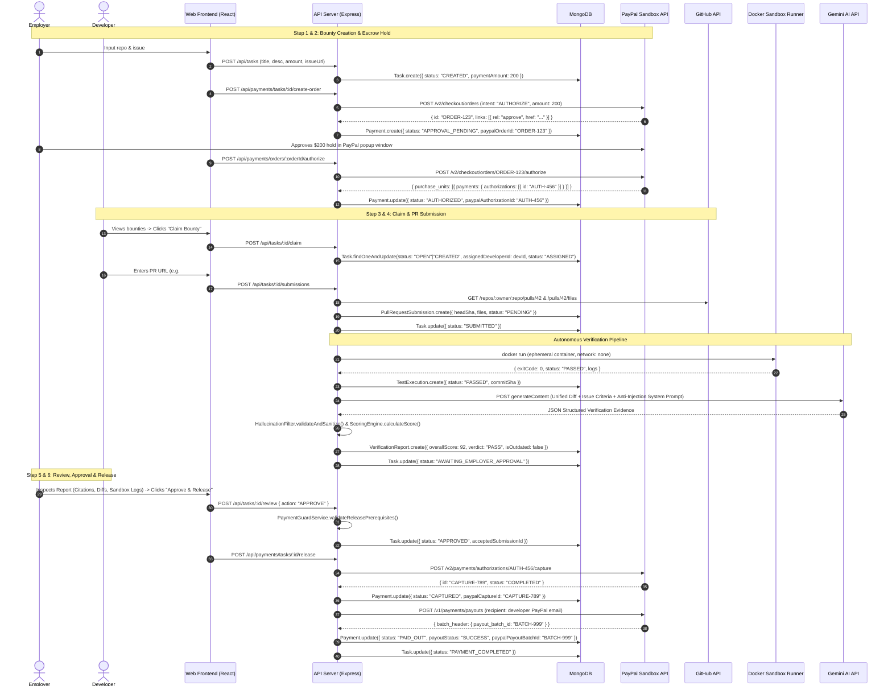
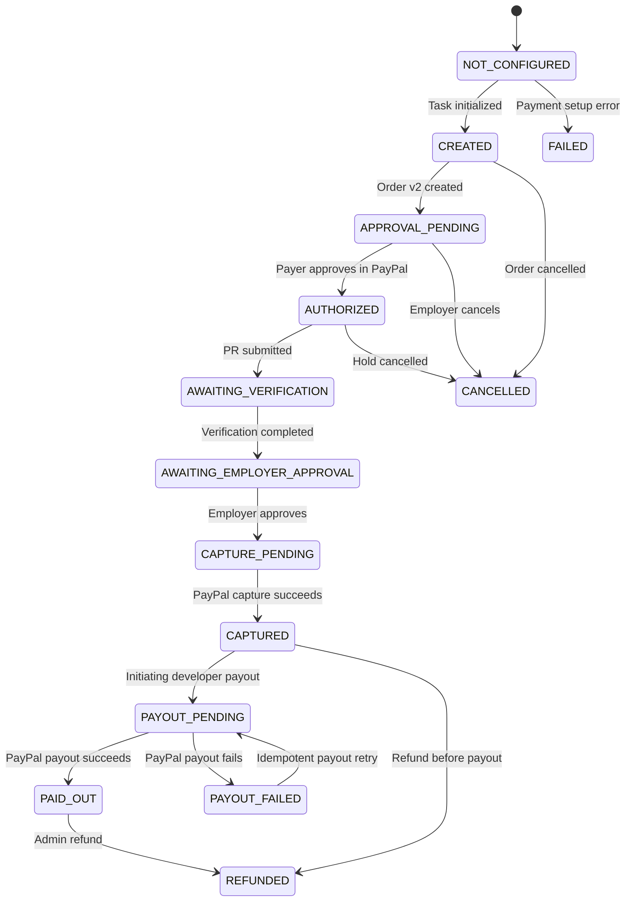

# OpenProofPay — Complete Codebase Audit, Architecture & End-to-End Workflow Report

This document details the complete internal architecture, payment lifecycle, AI verification pipeline, and security model of **OpenProofPay** based on static code inspection of the codebase.

---

# PART 1: Complete OpenProofPay Workflow



---

### Step 1: Employer Creates a Bounty

* **Who can create a bounty?**  
  Authenticated users with the `EMPLOYER` or `ADMIN` role. Enforced by authentication middleware `requireRole([UserRole.EMPLOYER, UserRole.ADMIN])` (`apps/api/src/modules/tasks/tasks.routes.ts`) and verified against project ownership in `TasksService.createTask` (`apps/api/src/modules/tasks/tasks.service.ts`).
* **What information is required?**  
  A valid `projectId`, `title`, `description` (automatically pulled from the GitHub issue markdown), `paymentAmount` or `bountyAmount` (> $0), and optional `issueNumber` and `issueUrl`.
* **Where is the bounty stored?**  
  Stored in the MongoDB collection `tasks` via `TaskModel` (`apps/api/src/models/Task.ts`).
* **Which database model is used?**  
  `TaskModel` implementing `ITaskDocument`.
* **What happens after clicking Create Bounty?**  
  In the frontend wizard `NewBountyScreen.tsx` (`apps/web/src/screens/NewBountyScreen.tsx`), the frontend creates the database task via `POST /api/tasks`, saves `createdTask`, and advances to **Step 3: Escrow Authorization Hold**.
* **What is the initial bounty and payment status?**  
  - Initial `Task.status`: `TaskStatus.CREATED`.
  - No `Payment` record exists yet until Step 3 is initiated.
* **Is money collected at this stage?**  
  **No.** No payment gateway call has been made, no money is collected, and no authorization hold has been established.

---

### Step 2: Employer Authorizes Payment Using PayPal Sandbox

When the employer clicks **"Authorize Hold with PayPal Sandbox"** (or the development bypass button):

1. **Frontend Handler**: Handled by `handleAuthorizePayPal` in `NewBountyScreen.tsx`.
2. **Backend API Endpoints & Controllers**:
   - First call: `POST /api/payments/tasks/:taskId/create-order` handled by `PaymentsController.createTaskOrder` (`apps/api/src/modules/payments/payments.controller.ts`) calling `PaymentsService.createTaskOrder` (`apps/api/src/modules/payments/payments.service.ts`).
   - Second call (post-checkout approval): `POST /api/payments/orders/:orderId/authorize` handled by `PaymentsController.recordAuthorization` calling `PaymentsService.recordAuthorization`.
3. **How PayPal Order is Created & Intent**:
   - `PayPalClient.createOrder` (`apps/api/src/modules/payments/PayPalClient.ts`) issues `POST /v2/checkout/orders` with headers `Authorization: Bearer <token>`, `PayPal-Request-Id: <idempotencyKey>`.
   - **Intent**: Crucially set to **`intent: "AUTHORIZE"`** (not `CAPTURE`), reserving funds on the payer's funding source without settling them into OpenProofPay's merchant balance.
4. **Employer Redirection & Approval**:
   - The PayPal API returns checkout links, including `{ rel: "approve", href: "https://www.sandbox.paypal.com/checkoutnow?token=..." }`.
   - The frontend opens this link in a popup window: `window.open(approveUrl, '_blank', 'width=600,height=700')`.
   - The employer logs into their PayPal Sandbox Personal account and clicks "Agree & Continue".
5. **Post-Approval Authorization Call**:
   - When the employer finishes approving, the frontend calls `POST /api/payments/orders/:orderId/authorize`.
   - The backend calls PayPal Sandbox API: **`POST /v2/checkout/orders/{orderId}/authorize`** via `PayPalClient.authorizeOrder`.
6. **MongoDB Storage**:
   - `paypalOrderId`: Stored in `PaymentModel.paypalOrderId` (`apps/api/src/models/Payment.ts`).
   - `paypalAuthorizationId`: Extracted from `orderRes.purchase_units[0].payments.authorizations[0].id` and stored in `PaymentModel.paypalAuthorizationId`.
7. **Database Status After Authorization**:
   - `Payment.status` transitions from `APPROVAL_PENDING` to **`PaymentStatus.AUTHORIZED`** (`apps/api/src/modules/payments/PaymentStateMachine.ts`).
   - `Task.status` remains `CREATED` (or `OPEN`).
8. **Financial Reality & The Meaning of "HOLD"**:
   - **Is money deducted from the employer's account?** **No.** Funds are **not** withdrawn or credited to OpenProofPay or the developer.
   - **Can the employer still use that money?** The issuing bank/PayPal puts an authorization hold (ring-fencing) against the employer's credit card credit line or PayPal balance. The employer cannot spend that portion on other transactions, guaranteeing liquidity for OpenProofPay.
   - **Does the developer receive anything?** **No.** Zero funds have moved to the developer.
   - **Definition of "HOLD" in OpenProofPay**: A cryptographic and financial reservation guarantee under PayPal Orders v2 Authorizations. The buyer authorizes OpenProofPay to capture up to $200 within PayPal's authorization validity window (3-day honor window, 29-day max validity) upon verified milestone completion.

---

### Step 3: Developer Discovers and Claims a Bounty

* **Discovery**:  
  Developers view active bounties on the home dashboard (`apps/web/src/screens/HomeScreen.tsx`) or list tasks via `GET /api/tasks?status=CREATED,OPEN,ASSIGNED`.
* **Claiming the Bounty**:  
  The developer navigates to `BountyPageScreen.tsx` (`apps/web/src/screens/BountyPageScreen.tsx`) and clicks **"Claim Bounty"**, calling `POST /api/tasks/:id/claim`.
* **Database Changes**:  
  `TasksService.startTask` (`apps/api/src/modules/tasks/tasks.service.ts`) executes an **atomic conditional find-and-modify**:
  ```typescript
  const atomicClaimed = await TaskModel.findOneAndUpdate(
    {
      _id: taskId,
      assignedDeveloperId: null,
      status: { $in: [TaskStatus.OPEN, TaskStatus.CREATED, TaskStatus.ASSIGNED] }
    },
    {
      $set: {
        assignedDeveloperId: new Types.ObjectId(developerId),
        status: TaskStatus.ASSIGNED
      }
    },
    { new: true }
  );
  ```
  An immutable audit record `AuditAction.TASK_ASSIGNED` is written to `auditlogs`.
* **Ownership Maintenance**:  
  `Task.assignedDeveloperId` is permanently bound to the claiming developer's user ID.
* **Can Multiple Developers Claim the Same Bounty?**  
  **No.** The atomic MongoDB query requires `assignedDeveloperId: null`. If two developers click "Claim" at the exact same millisecond, MongoDB's single-document write lock allows only one update to succeed.
* **What Happens if Already Claimed?**  
  The second developer's request receives an immediate **`409 Conflict`** error: `"This milestone task has already been claimed by another developer"` (`tasks.service.ts`).

---

### Step 4: Developer Submits Work Through GitHub

When the developer finishes coding, they open a GitHub Pull Request and submit the PR URL in `BountyPageScreen.tsx`. Alternatively, GitHub Webhooks auto-detect the PR.

1. **GitHub Repository Connection**:
   - Project repositories are tracked in `githubrepositories` (`apps/api/src/models/GitHubRepository.ts`).
   - GitHub API authentication uses the personal access token or GitHub App token configured via `env.GITHUB_ACCESS_TOKEN` (`apps/api/src/config/env.ts`).
2. **Issue & PR Data Retrieval**:
   - `POST /api/tasks/:taskId/submissions` calls `SubmissionsService.submitPR` (`apps/api/src/modules/submissions/submissions.service.ts`).
   - It fetches the PR metadata and the complete unified diff using Octokit / GitHub REST API:
     `GET /repos/{owner}/{repo}/pulls/{pull_number}` and `GET /repos/{owner}/{repo}/pulls/{pull_number}/files`.
   - The submission is recorded in `pullrequestsubmissions` (`apps/api/src/models/PullRequestSubmission.ts`), capturing `headSha`, `baseBranch`, `headBranch`, `additions`, `deletions`, `changedFilesCount`, and the per-file diff patches.
   - `Task.status` transitions to **`SUBMITTED`**.
3. **The Three Verification Pillars (Clearly Distinguished)**:
   - **Pillar A: GitHub Actions CI Status (`ciTestStatus`)**:
     - Queried via `GitHubService.getCommitCheckRuns` (`GET /repos/{owner}/{repo}/commits/{ref}/check-runs`).
     - Checks the developer's external CI/CD build status (`PASSED`, `FAILED`, `PENDING`).
   - **Pillar B: OpenProofPay Isolated Sandbox Testing (`TestExecutionModel`)**:
     - Executed by `TestRunnerService.executeSubmissionTests` (`apps/api/src/modules/test-runner/test-runner.service.ts`) using `DockerSandboxRunner` (`apps/api/src/modules/test-runner/DockerSandboxRunner.ts`).
     - **Mechanism**: Automatically spins up an ephemeral Docker container (`docker run --rm --network none -m 512m --cpus 1.0 ...`), mounts the repository code, detects the test framework (`jest`, `mocha`, `npm test`, `pytest`), runs the test suite in strict isolation with zero network access, captures exit codes and stdout/stderr, sanitizes sensitive tokens via `LogSanitizer`, and records the outcome in `testexecutions` (`apps/api/src/models/TestExecution.ts`).
   - **Pillar C: Gemini AI Semantic Requirement Verification & Code Citations**:
     - Executed by `AIVerificationService.verifySubmission` (`apps/api/src/modules/ai-verification/ai-verification.service.ts`).
     - Assembles unified diffs, acceptance criteria, and issue descriptions.
     - Protects against prompt injection using `PromptSecurity.getHardenedSystemPrompt()`.
     - Calls Gemini with structured JSON output requirements.
     - **Anti-Hallucination Gate**: Runs `HallucinationFilter.validateAndSanitize` (`apps/api/src/modules/ai-verification/HallucinationFilter.ts`) to match every line number and code quote cited by the AI against the real file patch on disk. Any citation not existing in the real commit is stripped.
     - **Deterministic Scoring**: `ScoringEngine.calculateScore` (`apps/api/src/modules/ai-verification/ScoringEngine.ts`) applies deterministic mathematical weights (Criteria 40%, Sandbox Tests 20%, Security 20%, Code Quality 20%) to produce an overall score from 0 to 100 and a verdict (`PASS` or `FAIL`).
     - Previous reports for older commits are marked `isOutdated: true`. The new report is stored in `verificationreports` (`apps/api/src/models/VerificationReport.ts`).
   - `Task.status` advances to **`AWAITING_EMPLOYER_APPROVAL`** (or `VERIFICATION_FAILED`).

---

### Step 5: Employer Reviews Submitted Work

* **Where the Employer Sees the Submission**:  
  On the dedicated review interface `ReviewPageScreen.tsx` (`apps/web/src/screens/ReviewPageScreen.tsx`).
* **What Evidence is Displayed**:  
  1. The commit SHA badge with one-click copy.
  2. The overall verification score (e.g. `92/100`) and verdict (`PASS` / `FAIL`).
  3. Acceptance criteria checklist showing verified line quotes from changed files.
  4. Expandable unified diff viewers.
  5. Security vulnerability findings (CWE classifications, file locations).
  6. Sandbox container test execution results (exit code, test count, sanitized terminal logs).
  7. GitHub Actions CI check run indicators.
* **What Happens When Employer Reviews**:
  - **Approve**: Employer clicks "Approve & Release". Task transitions to `APPROVED` and payment capture is triggered.
  - **Request Changes**: Employer submits notes. `TasksService.reviewTask` (`apps/api/src/modules/tasks/tasks.service.ts`) transitions `Task.status` to **`REVISION_REQUESTED`** and sends a notification to the developer.
  - **Reject**: Employer provides a mandatory rejection reason. Task transitions to **`REJECTED`** (`tasks.service.ts`).

---

### Step 6: Employer Approves Work and Releases Payment

1. **What Triggers Payment Release**:  
   Employer clicks **"Approve & Release"** on `ReviewPageScreen.tsx`, calling `POST /api/tasks/:id/review` with `{ action: "APPROVE" }` followed by `POST /api/payments/tasks/:id/release`.
2. **Backend Route & Controller**:  
   Routed via `POST /api/payments/tasks/:taskId/release` (`apps/api/src/modules/payments/payments.routes.ts`) to `PaymentsController.releasePayment` calling `PaymentsService.releasePayment`.
3. **Validations Preventing Unauthorized Release (The Proof-to-Pay Gate)**:  
   `PaymentGuardService.validateReleasePrerequisites` (`apps/api/src/modules/payments/PaymentGuardService.ts`) verifies:
   - **Ownership (Anti-IDOR)**: Caller must be the task's `employerId` or an `ADMIN`.
   - **Self-Approval Guard**: `task.assignedDeveloperId !== caller.id`.
   - **Human Approval Gate**: `task.status === TaskStatus.APPROVED`. Funds cannot be released on AI verdict alone.
   - **Anti-Double-Capture Gate**: `payment.status !== CAPTURED && payment.status !== PAID_OUT`.
   - **Report Freshness & SHA Match**: `verificationReport.isOutdated === false` and `verificationReport.commitSha === submission.headSha`.
   - **Test Execution Gate**: A container test execution or CI evaluation record must be present.
4. **Double-Capture Prevention**:  
   Enforced in MongoDB via status check and on PayPal via strict 36-character idempotency key (`cap-${paymentId}`) passed in `PayPal-Request-Id`.
5. **PayPal API Endpoint for Capture**:  
   Calls **`POST /v2/payments/authorizations/{authorization_id}/capture`** via `PayPalClient.captureAuthorization`.
6. **Disbursement to Developer (Capture vs. Payout)**:  
   - In PayPal's merchant model, **Capture** pulls the authorized $200 from the employer into OpenProofPay's merchant account.
   - Capture does **not** automatically route funds to the developer's external personal PayPal wallet.
   - Immediately after capture, `PaymentsService.releasePayment` determines the developer's registered receiver email (`developer.paypalEmail || developer.email`) and calls **`POST /v1/payments/payouts`** via `PayPalClient.createPayout`.
7. **What Happens if Payout Fails After Capture Succeeds?**  
   - Handled defensively in `payments.service.ts`.
   - The payment record **preserves its `CAPTURED` state** (`currentPayment.status = PaymentStatus.CAPTURED; currentPayment.payoutStatus = 'FAILED'`).
   - The funds are safely stored in OpenProofPay's merchant wallet; the system does not roll back capture.
   - The employer receives a notification and can retry the payout idempotently via `PaymentsService.retryPayout` (`POST /api/payments/tasks/:taskId/retry-payout`).
8. **Storage of IDs & Final Statuses**:
   - `paypalCaptureId` is stored in `PaymentModel.paypalCaptureId`.
   - `paypalPayoutBatchId` is stored in `PaymentModel.paypalPayoutBatchId`.
   - Final `Payment.status`: **`PAID_OUT`** (or `CAPTURED` if payout pending).
   - Final `Task.status`: **`PAYMENT_COMPLETED`**.

---

### Step 7: Employer Rejects Work or Cancels Bounty

* **Rejection Flow**:  
  When the employer rejects the submission via `POST /api/tasks/:id/review` (`action: "REJECT"`), `Task.status` transitions to `REJECTED`. The authorization hold remains intact in PayPal until voided or expired.
* **Resubmission After Rejection / Revision Request**:  
  - If status is `REVISION_REQUESTED` or `REJECTED`, the developer pushes new commits to their PR branch or resubmits the PR URL.
  - The GitHub webhook or developer manual submission triggers a fresh verification run. The outdated report is marked `isOutdated: true`, a new report is generated for the new commit SHA, and `Task.status` transitions back to `SUBMITTED` -> `VERIFYING` -> `AWAITING_EMPLOYER_APPROVAL`.
* **Bounty Cancellation Flow**:  
  `POST /api/payments/orders/:orderId/cancel` calls `PaymentsService.cancelOrder`, which transitions `Payment.status` to **`CANCELLED`** in MongoDB.
* **Does Cancellation Release the PayPal Hold?**  
  **No (Technical Limitation Found):** In `PaymentsService.cancelOrder`, the backend updates the local MongoDB status to `CANCELLED`, but **does not issue a `POST /v2/payments/authorizations/{id}/void` request** to PayPal's API. The hold in PayPal remains until it reaches PayPal's natural 29-day expiration.
* **Handling Expired Authorizations**:  
  PayPal authorizations expire after 29 days (with a 3-day honor guarantee). The webhook listener `handlePayPalEvent` (`apps/api/src/modules/webhooks/webhooks.service.ts`) receives `PAYMENT.AUTHORIZATION.VOIDED` if voided/expired, but there is no automated background cron to refresh or alert on expiring holds.

---

# PART 2: PayPal Authorization vs. Capture Concept

### Step-by-Step Financial Walkthrough: Alice ($200 Bounty) and Bob (Developer)

| Stage | Action | Alice's Balance / Bank Hold | PayPal Escrow / Hold | Bob's Balance | Platform Balance |
|---|---|---|---|---|---|
| **1. Bounty Created** | Alice posts $200 milestone bounty | $1,000 available (no deduction) | $0 | $0 | $0 |
| **2. Auth Hold Created** | Alice completes PayPal Sandbox authorization checkout | $800 available / **$200 on HOLD** | **$200 reserved** (Guaranteed by PayPal) | $0 | $0 (Zero fee, zero custody) |
| **3. Development & AI Proof** | Bob claims, codes, submits PR; Gemini + Docker tests score 92/100 | $800 available / $200 on HOLD | $200 reserved | $0 | $0 |
| **4. Human Review & Approval** | Alice clicks "Approve & Release" | $800 available / $200 on HOLD | $200 reserved | $0 | $0 |
| **5. PayPal Capture** | Backend captures authorization `AUTH-456` | **$200 permanently deducted** ($800 available) | Hold cleared | $0 | **+$200 in platform PayPal account** |
| **6. Developer Payout** | Backend executes PayPal Payout to Bob's PayPal email | $800 available (settled) | $0 | **+$200 in Bob's PayPal wallet** | $0 (Funds completely disbursed) |

---

### PayPal Order ID vs. Authorization ID vs. Capture ID

```mermaid
flowchart LR
    A["Order ID (paypalOrderId)"] -->|POST /v2/checkout/orders/{id}/authorize| B["Authorization ID (paypalAuthorizationId)"]
    B -->|POST /v2/payments/authorizations/{id}/capture| C["Capture ID (paypalCaptureId)"]
    C -->|POST /v1/payments/payouts| D["Payout Batch ID (paypalPayoutBatchId)"]
```

#### 1. PayPal Order ID (`paypalOrderId`)
* **What it represents**: A temporary PayPal checkout agreement and cart container (`v2/checkout/orders`).
* **When generated**: Generated in Step 2 when the employer initiates bounty escrow funding.
* **MongoDB Storage**: `PaymentModel.paypalOrderId` (`apps/api/src/models/Payment.ts`) (String, unique, indexed).
* **Format**: Typically a 17-character alphanumeric string (e.g., `5O190127TN364715T` or `MOCK-ORDER-...`).

#### 2. PayPal Authorization ID (`paypalAuthorizationId`)
* **What it represents**: A legal and financial hold reserving specific funds on the employer’s payment instrument (`v2/payments/authorizations`). It guarantees money is available for future capture.
* **When generated**: Generated when the employer finishes PayPal approval and the server calls `POST /v2/checkout/orders/{orderId}/authorize`.
* **MongoDB Storage**: `PaymentModel.paypalAuthorizationId` (String, indexed).
* **Format**: String starting with an authorization prefix (e.g., `2C8432517G471232B` or `AUTH-...`).

#### 3. PayPal Capture ID (`paypalCaptureId`)
* **What it represents**: The permanent settlement transaction confirming the transfer of funds from the employer's bank into OpenProofPay's merchant account (`v2/payments/captures`).
* **When generated**: Generated in Step 6 when the employer approves the PR and calls `POST /api/payments/tasks/:id/release`.
* **MongoDB Storage**: `PaymentModel.paypalCaptureId` (String).
* **Format**: Transaction capture string (e.g., `87V1234567890123A` or `CAPTURE-...`).

---

# PART 3: Complete Technical Flow

### Architecture Mapping Matrix

| Step / Action | Frontend Component | Route / API Endpoint | Controller & Function | Database Model & Fields Updated | External Service Called |
|---|---|---|---|---|---|
| **1. Create Bounty** | `NewBountyScreen.tsx` | `POST /api/tasks` | `TasksController.createTask` -> `TasksService.createTask` | `TaskModel` (`title`, `description`, `paymentAmount`, `status: 'CREATED'`) | None |
| **2. Create Order** | `NewBountyScreen.tsx` | `POST /api/payments/tasks/:id/create-order` | `PaymentsController.createTaskOrder` -> `PaymentsService.createTaskOrder` | `PaymentModel` (`paypalOrderId`, `amount`, `status: 'APPROVAL_PENDING'`) | PayPal `POST /v2/checkout/orders` |
| **3. Authorize Hold** | `NewBountyScreen.tsx` | `POST /api/payments/orders/:orderId/authorize` | `PaymentsController.recordAuthorization` -> `PaymentsService.recordAuthorization` | `PaymentModel` (`paypalAuthorizationId`, `status: 'AUTHORIZED'`, `approvedAt`) | PayPal `POST /v2/checkout/orders/{id}/authorize` |
| **4. Claim Bounty** | `BountyPageScreen.tsx` | `POST /api/tasks/:id/claim` | `TasksController.claimTask` -> `TasksService.startTask` | `TaskModel` (`assignedDeveloperId`, `status: 'ASSIGNED'`), `AuditLogModel` | None |
| **5. Submit PR** | `BountyPageScreen.tsx` | `POST /api/tasks/:id/submissions` | `SubmissionsController.submitPR` -> `SubmissionsService.submitPR` | `PullRequestSubmissionModel` (`headSha`, `files`, `status: 'PENDING'`), `TaskModel` (`status: 'SUBMITTED'`) | GitHub `GET /repos/{owner}/{repo}/pulls/{number}` |
| **6. Sandbox Testing** | Triggered automatically by API | Internal Service Call | `TestRunnerService.executeSubmissionTests` | `TestExecutionModel` (`exitCode`, `status`, `sanitizedLogs`, `passedTests`, `failedTests`) | Local Docker Daemon (`docker run --rm --network none`) |
| **7. AI Verification** | Triggered automatically by API | Internal Service Call | `AIVerificationService.verifySubmission` | `VerificationReportModel` (`overallScore`, `verdict`, `requirementAnalysis`, `isOutdated: false`), `TaskModel` (`status: 'AWAITING_EMPLOYER_APPROVAL'`) | Gemini API (`models/gemini-2.0-flash:generateContent`) |
| **8. Employer Approval** | `ReviewPageScreen.tsx` | `POST /api/tasks/:id/review` | `TasksController.reviewTask` -> `TasksService.reviewTask` | `TaskModel` (`status: 'APPROVED'`, `acceptedSubmissionId`, `latestReview`) | None |
| **9. Release & Capture** | `ReviewPageScreen.tsx` | `POST /api/payments/tasks/:id/release` | `PaymentsController.releasePayment` -> `PaymentsService.releasePayment` | `PaymentModel` (`paypalCaptureId`, `status: 'CAPTURED'`), `PaymentEventModel` | PayPal `POST /v2/payments/authorizations/{id}/capture` |
| **10. Developer Payout** | Automatic backend post-capture | Executed inside `releasePayment` | `PaymentsService.releasePayment` | `PaymentModel` (`paypalPayoutBatchId`, `status: 'PAID_OUT'`, `payoutStatus: 'SUCCESS'`), `TaskModel` (`status: 'PAYMENT_COMPLETED'`) | PayPal `POST /v1/payments/payouts` |
| **11. Webhook Processing** | External PayPal Webhook Event | `POST /api/webhooks/paypal` | `WebhooksController.handlePayPalWebhook` -> `WebhookService.handlePayPalEvent` | `PaymentModel` (reconciles status), `PaymentEventModel` | PayPal `POST /v1/notifications/verify-webhook-signature` |

---

# PART 4: 12 Specific Implementation Questions

### 1. Is payment authorization mandatory before a bounty becomes available?
* **Actual Implementation**:
  - In the UI workflow (`NewBountyScreen.tsx`), Step 3 enforces payment authorization before showing the success screen or linking to the dashboard.
  - **In the Backend Database**: The `Task` record is inserted in Step 2 with `status: CREATED` before authorization occurs.
  - **Audit Verdict**: It is strictly guided in the UI, but at the raw API level a task exists in MongoDB before the authorization is finalized.

### 2. Can a developer claim a bounty without an authorized payment?
* **Actual Implementation**:
  - In `TasksService.startTask`, the claim condition is:
    ```typescript
    {
      _id: taskId,
      assignedDeveloperId: null,
      status: { $in: [TaskStatus.OPEN, TaskStatus.CREATED, TaskStatus.ASSIGNED] }
    }
    ```
  - The query **does not join or assert `Payment.status === 'AUTHORIZED'`**.
  - **Audit Verdict**: **Yes.** A developer calling `POST /api/tasks/:id/claim` directly can claim a task even if the employer closed their browser before completing the PayPal hold.

### 3. Can an employer approve work without successful AI verification?
* **Actual Implementation**:
  - In `TasksService.reviewTask`, the checks on the report verify that if a report exists, it must not be outdated (`!latestReport.isOutdated`) and its commit SHA must match (`latestReport.commitSha === latestSubmission.headSha`).
  - However, **it does not assert `latestReport.verdict === 'PASS'` or `overallScore >= minVerificationScore`**.
  - Furthermore, in `VerificationReportModel`, `isDecisionSupportOnly: true` is explicitly configured.
  - **Audit Verdict**: **Yes.** The system treats AI as an advisory decision-support system. An employer has the human authority to override an AI failure and approve the deliverable.

### 4. Can an employer approve work even if GitHub Actions fails?
* **Actual Implementation**:
  - In `PaymentGuardService.ts`, `hasCIEvaluation` evaluates whether `ciTestStatus === 'PASSED' || ciTestStatus === 'FAILED'`.
  - The check requires that CI was *evaluated*, not that it *passed*.
  - **Audit Verdict**: **Yes.** A failing GitHub Actions run does not block human approval or payout release.

### 5. Is sandbox testing mandatory?
* **Actual Implementation**:
  - In `PaymentGuardService.ts`, the release gate checks:
    ```typescript
    if (!testExecution && !hasCIEvaluation) {
      throw AppError.badRequest('Proof-to-Pay Gate blocked: Isolated container test execution record is missing for this submission', 'TEST_EXECUTION_MISSING');
    }
    ```
  - In environments without a running Docker daemon, `DockerSandboxRunner.runInSandbox` creates a record with `status: 'COULD_NOT_EXECUTE'`.
  - **Audit Verdict**: The presence of a test execution record or CI check is mandatory, but successful test completion is not strictly enforced if Docker is down.

### 6. Can payment be captured without human approval?
* **Actual Implementation**:
  - In `PaymentGuardService.ts`:
    ```typescript
    if (task.status !== TaskStatus.APPROVED) {
      throw AppError.badRequest(
        `Proof-to-Pay Gate blocked: Milestone deliverable must be in 'APPROVED' status before release (current: ${task.status}). Human employer review is required.`,
        'TASK_NOT_APPROVED'
      );
    }
    ```
  - **Audit Verdict**: **No.** Payment capture is strictly impossible without explicit human employer approval transitioning the task to `APPROVED`.

### 7. Can the same authorization be captured twice?
* **Actual Implementation**:
  - First check: `PaymentGuardService.ts` rejects any payment in `CAPTURED` or `PAID_OUT` status with HTTP `409 Conflict` (`PAYMENT_ALREADY_CAPTURED`).
  - Second check: PayPal API enforces deduplication using the `PayPal-Request-Id` idempotency header (`cap-${payment._id}`) generated in `PaymentsService.ts`.
  - **Audit Verdict**: **No.** Double capture is prevented both in the application tier and via PayPal's idempotency engine.

### 8. Is there proper authorization ownership validation?
* **Actual Implementation**:
  - In `PaymentGuardService.ts`:
    ```typescript
    const isEmployerOwner = task.employerId.toString() === actorId;
    const isAdmin = actorRole === UserRole.ADMIN;
    if (!isEmployerOwner && !isAdmin) {
      throw AppError.forbidden('Forbidden: Only the employer who posted this milestone can authorize payment release');
    }
    ```
  - In `PaymentsService.createTaskOrder`, callers are verified against `task.employerId`.
  - **Audit Verdict**: **Yes.** Robust anti-IDOR validation prevents unauthorized release across all payment routes.

### 9. What happens when PayPal capture succeeds but MongoDB update fails?
* **Actual Implementation**:
  - In `PaymentsService.releasePayment`, `PayPalClient.captureAuthorization` executes over the network first.
  - If the Node.js process crashes or MongoDB drops connection immediately after capture:
    - The funds are captured in PayPal.
    - MongoDB remains in status `CAPTURE_PENDING`.
    - PayPal Webhooks (`WebhookService.handlePayPalEvent`) listen for `PAYMENT.CAPTURE.COMPLETED` and asynchronously update `payment.status = CAPTURED` and save `payment.paypalCaptureId`.
  - **Audit Verdict**: Webhook reconciliation handles this eventually, but there is no atomic distributed two-phase commit transaction.

### 10. Are PayPal webhooks implemented and verified?
* **Actual Implementation**:
  - Webhooks are received at `POST /api/webhooks/paypal` in `webhooks.routes.ts`.
  - Signature verification is handled by `PayPalClient.verifyWebhookSignature`, calling PayPal API `POST /v1/notifications/verify-webhook-signature`.
  - Events are deduplicated in `PaymentEventModel` using `paypalWebhookId`.
  - **Audit Verdict**: **Yes.** Fully implemented with cryptographic signature verification and idempotent processing.

### 11. Is there a mechanism to handle expired authorizations?
* **Actual Implementation**:
  - PayPal holds typically expire after 29 days (3-day honor window).
  - The webhook handler `handlePayPalEvent` recognizes `PAYMENT.AUTHORIZATION.*` events.
  - However, there is **no automated background cron job or scheduled task** checking for expiring authorizations or warning the employer to re-authorize.
  - **Audit Verdict**: Incomplete. It relies purely on passive external webhooks with no active expiration monitor.

### 12. Is there a proper cancellation/void authorization flow?
* **Actual Implementation**:
  - In `PaymentsService.cancelOrder`, the method updates MongoDB status to `CANCELLED`:
    ```typescript
    const updatedPayment = await PaymentStateMachine.transition({
      payment,
      targetStatus: PaymentStatus.CANCELLED,
      actorId,
      eventType: 'PAYMENT_CANCELLED_BY_USER'
    });
    ```
  - Crucially, `PayPalClient.ts` has no `voidAuthorization` method calling `POST /v2/payments/authorizations/{id}/void`.
  - **Audit Verdict**: Incomplete. Cancelling a bounty in OpenProofPay cancels it in the local database, but does not explicitly release the authorization hold in PayPal Sandbox immediately.

---

# PART 5: Final Comprehensive Report

### 1. Simple User Journey
1. **Employer** posts an open GitHub issue as a milestone bounty, enters $200, and approves the PayPal authorization hold in the PayPal Sandbox popup.
2. **Developer** views open bounties on the dashboard, claims the bounty, develops the fix, and submits the GitHub Pull Request URL.
3. **OpenProofPay Platform** automatically tests the code in an isolated Docker container and runs Gemini AI verification with anti-hallucination line-citation filtering.
4. **Employer** visits the review page, inspects the verified citations and sandbox test logs, and clicks "Approve & Release".
5. **PayPal Engine** captures the $200 hold and disburses the bounty to the developer's registered PayPal account.

---

### 2. Complete Payment Lifecycle State Machine



---

### 3. Database Status & Enum Reference

#### `TaskStatus` (`apps/api/src/models/Task.ts`)
* `CREATED`: Initial task state created by employer.
* `OPEN`: Available on the public bounty board.
* `ASSIGNED`: Claimed atomically by a developer.
* `IN_PROGRESS`: Developer started work.
* `SUBMITTED`: Pull request URL received.
* `VERIFYING`: Sandbox tests & AI verification running.
* `VERIFICATION_PASSED`: Verification passed minimum score threshold.
* `VERIFICATION_FAILED`: Verification failed threshold.
* `AWAITING_EMPLOYER_APPROVAL`: Awaiting human review decision.
* `REVISION_REQUESTED`: Employer requested code changes.
* `REJECTED`: Employer rejected deliverable.
* `APPROVED`: Employer approved deliverable (Proof-to-Pay Gate unlocked).
* `PAYMENT_COMPLETED`: Payout finalized.
* `CLOSED`: Terminal lifecycle state.

#### `PaymentStatus` (`apps/api/src/models/Payment.ts`)
* `NOT_CONFIGURED`: Default initial state before order setup.
* `CREATED`: PayPal Order v2 created.
* `APPROVAL_PENDING`: Awaiting employer checkout popup completion.
* `AUTHORIZED`: PayPal hold established (`paypalAuthorizationId` saved).
* `AWAITING_VERIFICATION`: Development work submitted for verification.
* `AWAITING_EMPLOYER_APPROVAL`: Verification finished, awaiting human sign-off.
* `CAPTURE_PENDING`: Capture initiated.
* `CAPTURED`: Funds captured into platform PayPal account (`paypalCaptureId` saved).
* `PAYOUT_PENDING`: Disbursing funds to developer.
* `PAID_OUT`: Funds successfully transferred to developer's wallet.
* `PAYOUT_FAILED`: Capture succeeded, but payout call failed.
* `CANCELLED`: Order cancelled.
* `REFUNDED`: Captured funds refunded to employer.

#### `SubmissionStatus` (`apps/api/src/models/PullRequestSubmission.ts`)
* `PENDING`: Initial submission saved.
* `EVALUATING`: Verification pipeline running.
* `PASSED`: Submission satisfied all criteria.
* `FAILED`: Submission failed verification criteria or sandbox tests.

---

### 4. Complete List of API Endpoints

#### Tasks & Submissions
* `POST /api/tasks` — Create a new bounty task (`apps/api/src/modules/tasks/tasks.controller.ts`)
* `GET /api/tasks` — List tasks with role-based filtering (`apps/api/src/modules/tasks/tasks.controller.ts`)
* `GET /api/tasks/:id` — Get task with submissions, reports, and test executions (`apps/api/src/modules/tasks/tasks.controller.ts`)
* `POST /api/tasks/:id/claim` — Atomically claim open bounty (`apps/api/src/modules/tasks/tasks.controller.ts`)
* `POST /api/tasks/:id/submissions` — Submit GitHub PR URL (`apps/api/src/modules/submissions/submissions.controller.ts`)
* `POST /api/tasks/:id/verify` — Manually trigger AI verification pipeline (`apps/api/src/modules/ai-verification/ai-verification.controller.ts`)
* `POST /api/tasks/:id/review` — Employer review decision (`APPROVE`, `REQUEST_REVISION`, `REJECT`) (`apps/api/src/modules/tasks/tasks.controller.ts`)

#### Payments & Escrow
* `POST /api/payments/tasks/:taskId/create-order` — Create PayPal Order v2 with `intent: 'AUTHORIZE'` (`apps/api/src/modules/payments/payments.controller.ts`)
* `POST /api/payments/orders/:orderId/authorize` — Confirm authorization hold post-checkout (`apps/api/src/modules/payments/payments.controller.ts`)
* `POST /api/payments/tasks/:taskId/release` — Execute capture and developer payout (`apps/api/src/modules/payments/payments.controller.ts`)
* `POST /api/payments/tasks/:taskId/retry-payout` — Retry developer payout for captured bounties (`apps/api/src/modules/payments/payments.controller.ts`)
* `POST /api/payments/orders/:orderId/cancel` — Cancel payment order (`apps/api/src/modules/payments/payments.controller.ts`)
* `GET /api/payments/tasks/:taskId` — Retrieve payment record and audit trail (`apps/api/src/modules/payments/payments.controller.ts`)
* `GET /api/payments/history` — Get user payment transaction history (`apps/api/src/modules/payments/payments.controller.ts`)

#### Webhooks & GitHub
* `POST /api/webhooks/paypal` — Process PayPal webhook events with signature verification (`apps/api/src/modules/webhooks/webhooks.controller.ts`)
* `POST /api/webhooks/github` — Process GitHub PR and issue webhooks with HMAC validation (`apps/api/src/modules/webhooks/webhooks.controller.ts`)
* `GET /api/github/repos/:owner/:repo/issues/:issueNumber` — Fetch issue description and metadata (`apps/api/src/modules/github/github.controller.ts`)

---

### 5. Key Source Files & Functions Directory

* `apps/api/src/modules/payments/PaymentGuardService.ts`: Enforces the Proof-to-Pay Gate, verifying human employer approval, PR existence, fresh AI report, container test record, and double-capture protection.
* `apps/api/src/modules/payments/payments.service.ts`: Implements `createTaskOrder`, `recordAuthorization`, `releasePayment`, `retryPayout`, and `cancelOrder`.
* `apps/api/src/modules/payments/PayPalClient.ts`: Direct integration layer for PayPal REST APIs v1 and v2, OAuth2 token caching, and idempotency key injection.
* `apps/api/src/modules/tasks/tasks.service.ts`: Manages task CRUD, atomic claim locking in `startTask`, and review gatekeeper logic in `reviewTask`.
* `apps/api/src/modules/ai-verification/ai-verification.service.ts`: Coordinates the autonomous verification pipeline, prompt generation, LLM invocation, anti-hallucination sanitization, and score persistence.
* `apps/api/src/modules/ai-verification/HallucinationFilter.ts`: Validates every line number and code quote against the real commit diff.
* `apps/api/src/modules/test-runner/DockerSandboxRunner.ts`: Ephemeral container test execution runner with network isolation.
* `apps/web/src/screens/NewBountyScreen.tsx`: Bounty creation wizard and PayPal Sandbox hold authorization modal.
* `apps/web/src/screens/ReviewPageScreen.tsx`: Employer review interface displaying verification evidence, test execution logs, and decision modals.

---

### 6. Identified Incomplete or Unsafe Areas

1. **Lack of PayPal Void Authorization Call on Bounty Cancellation**:
   In `PaymentsService.cancelOrder`, cancelling an order transitions MongoDB to `CANCELLED`, but does not invoke PayPal's `POST /v2/payments/authorizations/{id}/void` API endpoint. The employer's funds remain locked on their card until PayPal's 29-day authorization window expires.
2. **Missing Active Authorization Expiration Monitor**:
   There is no background cron job or scheduled monitor checking for authorizations approaching their 29-day limit (or 3-day honor period). If a complex bounty takes longer than 29 days to solve, the authorization silently expires, and capture will fail when approved.
3. **Task Claim Allowed Prior to Payment Authorization**:
   `TasksService.startTask` does not check whether `Payment.status === 'AUTHORIZED'`. If a task is created via direct API or the employer navigates away before completing PayPal checkout, a developer can still claim and submit work against an unfunded bounty.
4. **Developer Payout Receiver Email Fallback**:
   In `payments.service.ts`, when running in development mode without a registered developer PayPal email, the payout defaults to `developer-sandbox@openproofpay.local`. In production, if the developer has not configured their PayPal email, payout status transitions to `FAILED` with `payoutError: 'Developer has not configured a PayPal receiver email.'` while the money remains in the platform account.
