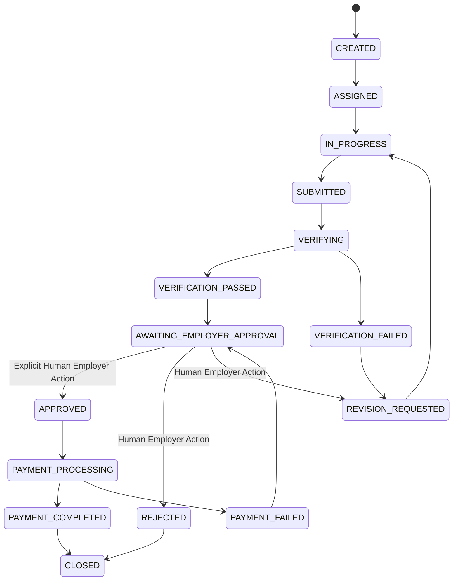

# OpenProofPay — Backend API Documentation & Security Architecture

## 1. Overview & Security Architecture

The OpenProofPay backend API (`/apps/api`) implements a defense-in-depth security model built around strict authentication, zero-secret exposure to client bundles, Anti-IDOR authorization guards, rate limiting, and an enforced state machine.

### Core Security Principles Implemented
1. **Zero Secret Leakage**: Passwords, JWT secrets, GitHub App private keys, and PayPal credentials are never transmitted to clients or logged in server logs.
2. **Centralized Error Handling**: Errors from Zod, Mongoose, and custom `AppError` instances are intercepted by a single middleware and formatted into clean error contracts. Stack traces are omitted in production.
3. **Defense Against Truncation Attacks**: Refresh tokens use a SHA-256 pre-hash before `bcrypt` processing (preventing the 72-byte truncation flaw inherent in bcrypt when handling raw JWT strings).
4. **Token Rotation & Anti-Theft**: Refresh tokens are rotated on every use. Reusing a stale refresh token immediately revokes the active session.
5. **Role-Based Access Control (RBAC)**: `requireRole([EMPLOYER, DEVELOPER, ADMIN])` enforces strict separation of concerns.
6. **Anti-IDOR**: `requireResourceOwnership` verifies that the caller owns the specific record before processing any mutation.
7. **Rate Limiting**: Multi-tiered rate limiters via `express-rate-limit` for standard, auth, payment, and webhook traffic.

---

## 2. API Endpoints

### 2.1 Health Check
* **Route**: `GET /health` or `GET /api/v1/health`
* **Access**: Public
* **Response (200 OK)**:
```json
{
  "success": true,
  "data": {
    "status": "UP",
    "timestamp": "2026-11-04T15:00:00.000Z",
    "service": "OpenProofPay API",
    "environment": "development"
  }
}
```

---

### 2.2 Authentication & Authorization (`/api/auth`)

#### `POST /api/auth/register`
* **Access**: Public
* **Validation**: Zod `RegisterUserSchema`
* **Password Policy**: Minimum 8 characters, at least 1 uppercase letter, 1 lowercase letter, and 1 number. Hashed via `bcrypt` (12 rounds).
* **Request Body**:
```json
{
  "email": "sarah.employer@company.com",
  "password": "SecurePassword123!",
  "name": "Sarah Employer",
  "role": "EMPLOYER",
  "githubUsername": "sarahemployer"
}
```
* **Response (201 Created)**:
```json
{
  "success": true,
  "data": {
    "user": {
      "id": "6724a1b0c9a...",
      "email": "sarah.employer@company.com",
      "name": "Sarah Employer",
      "role": "EMPLOYER",
      "githubConnected": true,
      "githubUsername": "sarahemployer",
      "createdAt": "2026-11-04T15:00:00.000Z"
    },
    "tokens": {
      "accessToken": "eyJhbGciOiJIUzI1NiIsInR5cCI6IkpXVCJ9...",
      "refreshToken": "eyJhbGciOiJIUzI1NiIsInR5cCI6IkpXVCJ9...",
      "expiresIn": 900
    }
  }
}
```
* **Cookie**: Sets `refreshToken` as an HTTP-only secure cookie.

#### `POST /api/auth/login`
* **Access**: Public
* **Validation**: Zod `LoginUserSchema`
* **Request Body**:
```json
{
  "email": "sarah.employer@company.com",
  "password": "SecurePassword123!"
}
```
* **Response (200 OK)**:
```json
{
  "success": true,
  "data": {
    "user": { ... },
    "tokens": {
      "accessToken": "...",
      "refreshToken": "...",
      "expiresIn": 900
    }
  }
}
```

#### `POST /api/auth/refresh`
* **Access**: Public (requires valid refresh token in body or HTTP-only cookie)
* **Behavior**: Validates JWT, verifies against hashed DB record, rotates token (invalidates old token immediately).
* **Request Body (Optional if Cookie provided)**:
```json
{
  "refreshToken": "eyJhbGciOiJIUzI1Ni..."
}
```
* **Response (200 OK)**:
```json
{
  "success": true,
  "data": {
    "tokens": {
      "accessToken": "...",
      "refreshToken": "...",
      "expiresIn": 900
    }
  }
}
```

#### `POST /api/auth/logout`
* **Access**: Authenticated (`requireAuth`)
* **Behavior**: Clears DB `refreshTokenHash`, clears `refreshToken` cookie.
* **Response (200 OK)**:
```json
{
  "success": true,
  "message": "Successfully logged out"
}
```

#### `GET /api/auth/me`
* **Access**: Authenticated (`requireAuth`)
* **Headers**: `Authorization: Bearer <accessToken>`
* **Response (200 OK)**:
```json
{
  "success": true,
  "data": {
    "user": {
      "id": "6724a1b0c9a...",
      "email": "sarah.employer@company.com",
      "name": "Sarah Employer",
      "role": "EMPLOYER",
      "githubConnected": true
    },
    "capabilities": {
      "canCreateMilestones": true,
      "canSubmitWork": false,
      "canApprovePayments": true
    }
  }
}
```

---

## 3. Controlled Task Lifecycle State Machine

Milestone progress is guarded by `TaskStateMachineService` (`/apps/api/src/services/TaskStateMachineService.ts`). Arbitrary mutation of task or payment status outside valid transitions is strictly prohibited.



### Transition Guard Rules
1. **Human Financial Sovereign Gate (Rule 13)**: Only an authenticated user with `UserRole.EMPLOYER` (or `ADMIN`) who owns the task's project can transition a task from `AWAITING_EMPLOYER_APPROVAL` to `APPROVED`.
2. **Immutable Audit Trail**: Every status transition automatically persists an append-only record in the `AuditLog` collection, logging `actorId`, `actorRole`, `previousStatus`, `newStatus`, and IP address.
3. **Invalid Transition Handling**: Any out-of-order transition (e.g. `CREATED` $\to$ `APPROVED`) throws `AppError.badRequest` with code `INVALID_STATE_TRANSITION` and HTTP 400.

---

## 4. Test Suite Summary

Integration tests run with `vitest` against an isolated MongoDB instance:
* `src/modules/auth/auth.integration.test.ts` (9 tests): Register, duplicate prevention, password policy validation, login, token rotation, reuse attacks, logout, me.
* `src/services/TaskStateMachineService.test.ts` (3 tests): Full 9-step happy path lifecycle, illegal jump rejection, developer self-approval prevention.
* `src/modules/auth/rbac.integration.test.ts` (6 tests): Role access guards, IDOR prevention, and Admin overrides.

**Total**: 18/18 passing.
