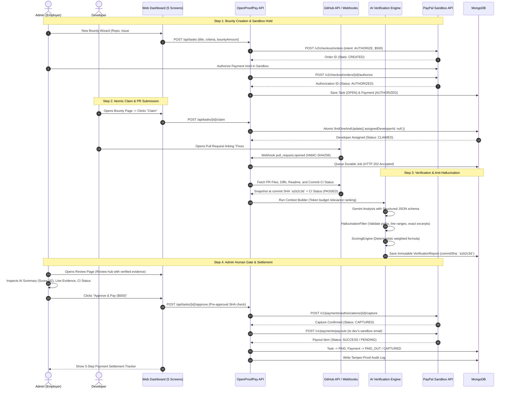

# OpenProofPay v2 — System Architecture Blueprint

> **Verification Status**: `VERIFIED`  
> Monorepo compilation, TypeScript strict checking, vitest test suites (137 backend tests + 6 frontend smoke tests) passed with 0 errors.

---

## 1. Product In One Sentence

> **GitHub issue + pull request -> AI checks the PR against the issue -> admin makes the final decision -> PayPal Sandbox pays the developer.**

**Core Invariant**: AI is decision support only. It can **never** approve work or move money autonomously. A merged PR is **not** approval.

---

## 2. Implementation Status & Component Audit

| Subsystem / Module | Status | Verification & Conformance Notes |
| :--- | :--- | :--- |
| **Monorepo Architecture** | `VERIFIED` | Root npm workspaces (`packages/shared`, `packages/config`, `apps/api`, `apps/web`, `apps/extension`). Unified build, typecheck, and test scripts. |
| **Authentication & RBAC** | `VERIFIED` | Password hashing (bcrypt 12 rounds), safe JWT access/refresh token rotation, strict RBAC (`EMPLOYER`/`ADMIN` vs `DEVELOPER`), anti-IDOR resource ownership guards. |
| **Bounty & Criteria Import** | `VERIFIED` | Import GitHub issue as bounty with amount, currency, and 2-6 structured acceptance criteria (each marked mandatory or optional). |
| **Atomic Claim Engine** | `VERIFIED` | Atomic conditional update (`TaskModel.findOneAndUpdate({ _id: taskId, assignedDeveloperId: null, status: { $in: [OPEN, CREATED, ASSIGNED] } })`) preventing race conditions between concurrent developers. |
| **PR Matching & SHA Binding** | `VERIFIED` | Matches incoming PRs via repository ID, issue reference ("Fixes/Closes/Resolves #N"), and claimed developer ID. Binds verification to exact head commit SHA. Outdates previous reports on `synchronize`. |
| **Verification Engine** | `VERIFIED` | Context builder with token budget (changed files -> callers/imports -> tests -> config), prompt injection isolation delimiters, Gemini structured JSON, anti-hallucination line-level excerpt validation against commit snapshot, deterministic scoring. |
| **CI Checks & Status** | `VERIFIED` | Reads GitHub Checks & Commit Statuses for exact head commit SHA. Reports honest enum: `PASSED`, `FAILED`, `PENDING`, `NOT_CONFIGURED`, `UNAVAILABLE`. Never fakes green. |
| **PayPal Sandbox Engine** | `VERIFIED` | Orders v2 `intent: AUTHORIZE` hold on bounty creation, human admin approval gate, server-side capture, developer payout via PayPal Payouts API, partial failure handling with stable idempotency key retry. |
| **5 Calm Frontend Screens** | `VERIFIED` | Strictly 5 screens: Home, New Bounty (3-step wizard), Bounty Page, Review Page (unified hub with sticky decision bar), Activity & Payments (AG Grid Community ledger & audit). |
| **Durable Job Worker** | `VERIFIED` | MongoDB-backed durable job queue (`WebhookJob`) with rapid HTTP 202 ack, crash recovery (`recoverStuckJobs`), exponential backoff, and idempotency. |
| **Render Cloud Blueprint** | `VERIFIED` | `render.yaml` orchestrating `openproofpay-api`, `openproofpay-worker`, and `openproofpay-web`. |
| **Hardened Docker Runner** | `PLANNED / STRETCH` | Hardened container runner (`--network none`, `--read-only`, non-root) exists as an optional extension for local test execution; GitHub CI check inspection is used as primary per v2 specifications. |

---

## 3. High-Level Architecture & Data Flow

```mermaid
flowchart TB
    subgraph ClientLayer["Calm 5-Screen UI & Chrome Extension"]
        WEB["Web Application (/apps/web)<br/>1. Home<br/>2. New Bounty<br/>3. Bounty Page<br/>4. Review Page<br/>5. Activity & Payments (AG Grid)"]
        EXT["Chrome Extension MV3 (/apps/extension)<br/>GitHub In-Context Sidepanel"]
    end

    subgraph APILayer["Backend Gateway (/apps/api)"]
        ROUTER["Express Gateway<br/>(JWT, RBAC, Anti-IDOR, Rate Limiting, Zod)"]
        
        subgraph CoreServices["Domain Services"]
            TASK_SVC["Task & Bounty Service<br/>(Atomic Claim, SHA Binding)"]
            VERIFY_SVC["Verification Engine<br/>(Token Budget, Gemini, Hallucination Filter)"]
            SCORE_SVC["Deterministic Scoring Engine<br/>(Section 3.5 Exact Formulas)"]
            PAY_SVC["PayPal Sandbox Service<br/>(Authorize Hold, Capture, Developer Payout)"]
            JOB_SVC["Durable Job Worker<br/>(Crash Recovery, Retry, Backoff)"]
            AUDIT_SVC["Audit Log Service<br/>(Append-Only Tamper-Proof Trail)"]
        end
    end

    subgraph ExternalServices["External Infrastructure"]
        GH_API["GitHub REST/GraphQL & Webhook API"]
        GEMINI_API["Google Gemini 2.5 / Pro LLM"]
        PAYPAL_SANDBOX["PayPal Developer Sandbox (Orders v2 & Payouts)"]
        MONGO_DB[("MongoDB Database & Durable Queue")]
    end

    WEB -->|REST / JSON| ROUTER
    EXT -->|REST / JSON| ROUTER
    GH_API -->|Webhooks (HMAC-SHA256)| ROUTER

    ROUTER --> TASK_SVC & VERIFY_SVC & PAY_SVC & AUDIT_SVC
    JOB_SVC --> VERIFY_SVC & PAY_SVC

    TASK_SVC --> MONGO_DB
    VERIFY_SVC -->|Repository Context| GH_API
    VERIFY_SVC -->|Structured Prompt| GEMINI_API
    VERIFY_SVC --> SCORE_SVC
    PAY_SVC -->|Hold / Capture / Payout| PAYPAL_SANDBOX
    AUDIT_SVC --> MONGO_DB
```

---

## 4. End-to-End Proof-to-Pay Sequence



---

## 5. Security & Verification Engine Architectural Details

### 5.1 Pre-Approval SHA Binding & Freshness Check
Before the Admin can approve a submission, `PaymentGuardService` and `tasks.service.ts` execute a pre-approval freshness check:
```typescript
if (submission.headSha !== verificationReport.commitSha) {
  throw new BadRequestException('COMMIT_SHA_MISMATCH: Report commit SHA does not match current PR head SHA. Re-verification required.');
}
```
If the developer pushes a new commit (`pull_request.synchronize`), the existing report is marked `isOutdated: true`, a new verification job is enqueued, and approval is blocked until the new report is evaluated.

### 5.2 Deterministic Scoring Formula (Section 3.5)
Scoring is strictly computed in deterministic backend TypeScript code, never by the LLM:
1. **When CI Tests are Not Evaluated** (`NOT_CONFIGURED`, `UNAVAILABLE`, `PENDING`):
   - Acceptance Criteria: **50%**
   - Security Findings: **25%**
   - Code Quality: **25%**
2. **When CI Tests are Evaluated** (`PASSED`, `FAILED`):
   - Acceptance Criteria: **40%**
   - Security Findings: **20%**
   - Code Quality: **20%**
   - CI Test Execution: **20%**
3. **Fail Caps**:
   - Any failed mandatory criterion caps the score at **≤ 60** with verdict **FAIL**.
   - Any critical security finding caps the score at **≤ 50** with verdict **FAIL**.

### 5.3 Anti-Hallucination Filter
Every evidence item generated by the LLM is inspected against the commit snapshot:
1. `filePath` existence check.
2. `lineStart` / `lineEnd` validity check against file line counts.
3. `codeExcerpt` exact substring search inside the targeted line range.
Any item failing these checks is flagged with `isVerified: false` and rendered as "Unverified Evidence" with an alert badge in the UI.

---

## 6. Frontend: Strictly 5 Calm Screens

The frontend is intentionally designed around generous whitespace, cards over tables, and single clear primary actions:

1. **Screen 1: Home (`HomeScreen.tsx`)**:
   - 3 stat cards: Open Bounties, Awaiting Review, Paid Out.
   - Filter chips (All, Open, Awaiting Review, Paid) + Search.
   - Role-specific primary CTA: "New Bounty" for Admin, "Browse Open Bounties" for Developer.
2. **Screen 2: New Bounty (`NewBountyScreen.tsx`)**:
   - 3-step guided wizard card:
     - Step 1: Pick repo & issue (auto-populates from GitHub or allows manual input).
     - Step 2: Set amount and 2-6 acceptance criteria (with mandatory toggles).
     - Step 3: Authorize PayPal Sandbox hold.
3. **Screen 3: Bounty Page (`BountyPageScreen.tsx`)**:
   - Issue summary, criteria checklist, reward amount, status timeline.
   - Single contextual action: "Claim Bounty", "Submit Pull Request", or "View Review".
4. **Screen 4: Review Page (`ReviewPageScreen.tsx`)**:
   - Unified hub laid out as stacked cards:
     - Header card with PR title, commit SHA, and Current/Outdated badge.
     - AI summary card with score ring and recommendation badge.
     - Criteria card with line-level verified/unverified evidence.
     - Security & quality findings card.
     - Honest GitHub CI checks card (`PASSED` / `FAILED` / `PENDING` / `NOT_CONFIGURED`).
     - Collapsible per-file diff card.
     - Sticky decision bar: `Approve & Pay` | `Request Changes` | `Reject`.
     - Post-approval 3-step payment tracker with Retry Payout support.
5. **Screen 5: Activity & Payments (`ActivityPaymentsScreen.tsx`)**:
   - The one place for a data grid: **AG Grid Community** displaying the payment ledger and immutable audit trail with quick filtering and CSV export.
