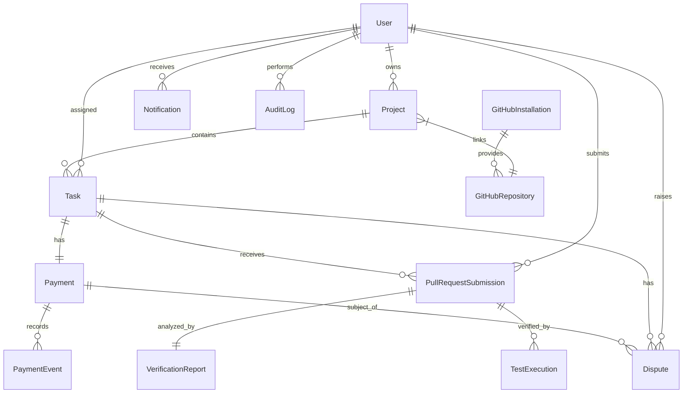

# OpenProofPay — Database Schema Specification

This document details the MongoDB / Mongoose collection schemas, data models, relations, field constraints, and indexing strategies for **OpenProofPay**.

---

## 1. Entity-Relationship Overview

---

## 2. Core Collections

### 2.1 `users`
Stores registered user accounts (Employers, Developers, and System Administrators).

| Field | Type | Validation / Index | Description |
| :--- | :--- | :--- | :--- |
| `_id` | `ObjectId` | Primary Key | MongoDB Unique ID |
| `email` | `String` | Required, Unique, Lowercase, Trim, Indexed | User email |
| `passwordHash` | `String` | Required (min 60 chars) | Argon2 / bcrypt hash |
| `name` | `String` | Required, Trim | Full name / Display name |
| `role` | `String (Enum)` | `['EMPLOYER', 'DEVELOPER', 'ADMIN']` | System authorization role |
| `githubUsername` | `String` | Optional, Sparse Unique, Trim | Linked GitHub handle |
| `githubId` | `String` | Optional, Sparse Unique | GitHub account ID from OAuth |
| `paypalReceiverEmail` | `String` | Optional, Lowercase, Trim | Developer's PayPal email for receiving bounties |
| `paypalMerchantId` | `String` | Optional | Employer's linked PayPal merchant ID |
| `isActive` | `Boolean` | Default: `true` | Account active status |
| `createdAt` | `Date` | Automatic timestamp | Account creation date |
| `updatedAt` | `Date` | Automatic timestamp | Last profile update |

**Indexes**:
- `{ email: 1 }` (unique)
- `{ githubUsername: 1 }` (sparse, unique)
- `{ role: 1 }`

---

### 2.2 `projects`
Represents an employer workspace managing tasks linked to GitHub repositories.

| Field | Type | Validation / Index | Description |
| :--- | :--- | :--- | :--- |
| `_id` | `ObjectId` | Primary Key | Unique project ID |
| `title` | `String` | Required, Max 140 chars | Project title |
| `description` | `String` | Optional, Max 2000 chars | Project scope and description |
| `employerId` | `ObjectId` | Ref: `User`, Required, Indexed | The employer owning the project |
| `githubRepoId` | `ObjectId` | Ref: `GitHubRepository`, Indexed | Linked GitHub repository |
| `currency` | `String` | Default: `'USD'`, Max 3 chars | Project currency standard |
| `totalBudget` | `Number` | Default: `0`, Min: `0` | Total allocated budget |
| `status` | `String (Enum)` | `['ACTIVE', 'ARCHIVED', 'SUSPENDED']` | Project operational status |
| `createdAt` | `Date` | Automatic timestamp | Creation date |
| `updatedAt` | `Date` | Automatic timestamp | Last update |

**Indexes**:
- `{ employerId: 1, status: 1 }`
- `{ githubRepoId: 1 }`

---

### 2.3 `tasks`
The central milestone unit defining the bounty, specifications, PR tracking, and status.

| Field | Type | Validation / Index | Description |
| :--- | :--- | :--- | :--- |
| `_id` | `ObjectId` | Primary Key | Unique task milestone ID |
| `projectId` | `ObjectId` | Ref: `Project`, Required, Indexed | Parent project |
| `title` | `String` | Required, Max 200 chars | Milestone task title |
| `description` | `String` | Required | Detailed requirements and acceptance criteria |
| `issueNumber` | `Number` | Optional, Indexed | Linked GitHub Issue number |
| `issueUrl` | `String` | Optional | URL to the GitHub issue |
| `assignedDeveloperId`| `ObjectId` | Ref: `User`, Optional, Indexed | Developer working on task |
| `status` | `String (Enum)` | `TaskStatus` Enum, Required, Indexed | Current task state in state machine |
| `bountyAmount` | `Number` | Required, Min: 1.00 | Milestone bounty payout in USD |
| `currency` | `String` | Default: `'USD'` | Currency |
| `minVerificationScore`| `Number` | Default: `80`, Min: 0, Max: 100 | Minimum AI score required to pass |
| `acceptedPrId` | `ObjectId` | Ref: `PullRequestSubmission`, Optional | Approved submission |
| `deadline` | `Date` | Optional | Milestone deadline |
| `createdAt` | `Date` | Automatic timestamp | Created timestamp |
| `updatedAt` | `Date` | Automatic timestamp | Last update |

**TaskStatus Enum Values**:
`CREATED`, `ASSIGNED`, `IN_PROGRESS`, `SUBMITTED`, `VERIFYING`, `VERIFICATION_PASSED`, `VERIFICATION_FAILED`, `AWAITING_EMPLOYER_APPROVAL`, `APPROVED`, `REJECTED`, `REVISION_REQUESTED`, `PAYMENT_PROCESSING`, `PAYMENT_COMPLETED`, `PAYMENT_FAILED`, `CLOSED`

**Indexes**:
- `{ projectId: 1, status: 1 }`
- `{ assignedDeveloperId: 1 }`
- `{ issueNumber: 1, projectId: 1 }`

---

### 2.4 `github_installations`
Stores GitHub App installations made by employers into their organizations or accounts.

| Field | Type | Validation / Index | Description |
| :--- | :--- | :--- | :--- |
| `_id` | `ObjectId` | Primary Key | Record ID |
| `installationId` | `Number` | Required, Unique, Indexed | GitHub App Installation ID |
| `accountLogin` | `String` | Required, Indexed | GitHub Org or User login name |
| `accountType` | `String (Enum)` | `['Organization', 'User']` | Account type |
| `targetId` | `Number` | Required | GitHub Account Target ID |
| `permissions` | `Object` | Required | Permission snapshot granted to the App |
| `installedBy` | `ObjectId` | Ref: `User`, Required, Indexed | The user who connected the App |
| `createdAt` | `Date` | Automatic timestamp | Install date |
| `updatedAt` | `Date` | Automatic timestamp | Update date |

**Indexes**:
- `{ installationId: 1 }` (unique)
- `{ installedBy: 1 }`

---

### 2.5 `github_repositories`
Stores repositories accessible via the GitHub App installations.

| Field | Type | Validation / Index | Description |
| :--- | :--- | :--- | :--- |
| `_id` | `ObjectId` | Primary Key | Record ID |
| `installationId` | `ObjectId` | Ref: `GitHubInstallation`, Required | Associated installation |
| `githubRepoId` | `Number` | Required, Unique, Indexed | GitHub repository ID |
| `fullName` | `String` | Required, Indexed | `owner/repo-name` format |
| `owner` | `String` | Required | Repo owner |
| `name` | `String` | Required | Repo name |
| `isPrivate` | `Boolean` | Required | Privacy status |
| `defaultBranch` | `String` | Default: `'main'` | Default branch |
| `webhookSecret` | `String` | Optional (encrypted) | Specific webhook secret |
| `createdAt` | `Date` | Automatic timestamp | Added date |
| `updatedAt` | `Date` | Automatic timestamp | Updated date |

**Indexes**:
- `{ githubRepoId: 1 }` (unique)
- `{ fullName: 1 }`

---

### 2.6 `pull_request_submissions`
Tracks developer submissions (Pull Requests) against specific tasks.

| Field | Type | Validation / Index | Description |
| :--- | :--- | :--- | :--- |
| `_id` | `ObjectId` | Primary Key | Submission ID |
| `taskId` | `ObjectId` | Ref: `Task`, Required, Indexed | Associated milestone task |
| `developerId` | `ObjectId` | Ref: `User`, Required, Indexed | Submitting developer |
| `prNumber` | `Number` | Required | GitHub PR number |
| `prUrl` | `String` | Required | GitHub PR web URL |
| `branchName` | `String` | Required | Branch name |
| `headCommitSha` | `String` | Required | Git SHA of the submitted head commit |
| `baseCommitSha` | `String` | Required | Git SHA of target base commit |
| `diffSummary` | `Object` | Required | Additions, deletions, changed files count |
| `status` | `String (Enum)` | `['PENDING', 'EVALUATING', 'PASSED', 'FAILED', 'ACCEPTED', 'REJECTED']` | Submission status |
| `submittedAt` | `Date` | Default: `Date.now` | PR submission timestamp |
| `updatedAt` | `Date` | Automatic timestamp | Last update |

**Indexes**:
- `{ taskId: 1, prNumber: 1 }`
- `{ developerId: 1 }`
- `{ headCommitSha: 1 }`

---

### 2.7 `verification_reports`
AI-generated evaluation report for a specific Pull Request submission.

| Field | Type | Validation / Index | Description |
| :--- | :--- | :--- | :--- |
| `_id` | `ObjectId` | Primary Key | Report ID |
| `submissionId` | `ObjectId` | Ref: `PullRequestSubmission`, Required, Unique | Associated PR submission |
| `taskId` | `ObjectId` | Ref: `Task`, Required, Indexed | Associated task |
| `score` | `Number` | Required, Min: 0, Max: 100 | Composite score from 0 to 100 |
| `verdict` | `String (Enum)` | `['PASS', 'FAIL', 'WARN']` | Algorithmic recommendation |
| `summary` | `String` | Required | Markdown summary of evaluation |
| `requirementsReview`| `Array` | List of `{ requirement: string, met: boolean, notes: string }` | Requirement checklist breakdown |
| `securityAnalysis` | `Array` | List of `{ severity: string, message: string, line: number, file: string }` | Vulnerability review |
| `codeQualityScore` | `Number` | Min: 0, Max: 100 | Clean code & architecture score |
| `aiModel` | `String` | Required | Model used (e.g., `gemini-2.5-pro`) |
| `rawOutput` | `String` | Optional | Raw LLM JSON response for audit |
| `generatedAt` | `Date` | Default: `Date.now` | Report timestamp |

**Indexes**:
- `{ submissionId: 1 }` (unique)
- `{ taskId: 1, generatedAt: -1 }`

---

### 2.8 `test_executions`
Logs and metrics for isolated container test execution of untrusted code.

| Field | Type | Validation / Index | Description |
| :--- | :--- | :--- | :--- |
| `_id` | `ObjectId` | Primary Key | Test execution ID |
| `submissionId` | `ObjectId` | Ref: `PullRequestSubmission`, Required, Indexed | Submission tested |
| `taskId` | `ObjectId` | Ref: `Task`, Required, Indexed | Associated milestone |
| `containerId` | `String` | Optional | Ephemeral Docker container ID |
| `status` | `String (Enum)` | `['QUEUED', 'RUNNING', 'PASSED', 'FAILED', 'TIMED_OUT', 'ERROR']` | Execution status |
| `exitCode` | `Number` | Optional | Exit code of test command |
| `stdout` | `String` | Optional | Standard output logs |
| `stderr` | `String` | Optional | Standard error logs |
| `testsTotal` | `Number` | Default: `0` | Total tests run |
| `testsPassed` | `Number` | Default: `0` | Passed count |
| `testsFailed` | `Number` | Default: `0` | Failed count |
| `durationMs` | `Number` | Default: `0` | Execution duration in ms |
| `cpuLimit` | `String` | Default: `'1.0'` | CPU quota applied |
| `memLimit` | `String` | Default: `'512m'` | Memory limit applied |
| `ranAt` | `Date` | Default: `Date.now` | Execution start time |

**Indexes**:
- `{ submissionId: 1, ranAt: -1 }`
- `{ taskId: 1 }`

---

### 2.9 `payments`
Tracks escrow, authorization, and capture lifecycle through PayPal Sandbox.

| Field | Type | Validation / Index | Description |
| :--- | :--- | :--- | :--- |
| `_id` | `ObjectId` | Primary Key | Payment record ID |
| `taskId` | `ObjectId` | Ref: `Task`, Required, Unique, Indexed | Linked milestone task |
| `projectId` | `ObjectId` | Ref: `Project`, Required, Indexed | Parent project |
| `employerId` | `ObjectId` | Ref: `User`, Required, Indexed | Payer |
| `developerId` | `ObjectId` | Ref: `User`, Optional, Indexed | Recipient payee |
| `amount` | `Number` | Required, Min: 1.00 | Payment amount |
| `currency` | `String` | Default: `'USD'` | Currency |
| `status` | `String (Enum)` | `PaymentStatus` Enum, Required, Indexed | State in payment state machine |
| `paypalOrderId` | `String` | Optional, Sparse Unique, Indexed | PayPal v2 Order ID |
| `paypalCaptureId` | `String` | Optional, Sparse Unique | PayPal v2 Capture ID |
| `paypalPayoutBatchId`| `String`| Optional | PayPal Payouts batch ID |
| `idempotencyKey` | `String` | Required, Unique, Indexed | Client idempotency UUID |
| `authorizedAt` | `Date` | Optional | Timestamp when funds authorized |
| `capturedAt` | `Date` | Optional | Timestamp when captured |
| `paidOutAt` | `Date` | Optional | Timestamp when paid to developer |
| `createdAt` | `Date` | Automatic timestamp | Created date |
| `updatedAt` | `Date` | Automatic timestamp | Updated date |

**PaymentStatus Enum Values**:
`NOT_CONFIGURED`, `CREATED`, `APPROVAL_PENDING`, `AUTHORIZED`, `AWAITING_VERIFICATION`, `AWAITING_EMPLOYER_APPROVAL`, `CAPTURE_PENDING`, `CAPTURED`, `PAYOUT_PENDING`, `PAID_OUT`, `FAILED`, `CANCELLED`, `REFUNDED`

**Indexes**:
- `{ taskId: 1 }` (unique)
- `{ paypalOrderId: 1 }` (sparse, unique)
- `{ idempotencyKey: 1 }` (unique)
- `{ employerId: 1, status: 1 }`

---

### 2.10 `payment_events`
Immutable append-only audit trail of every financial state transition and PayPal webhook.

| Field | Type | Validation / Index | Description |
| :--- | :--- | :--- | :--- |
| `_id` | `ObjectId` | Primary Key | Event ID |
| `paymentId` | `ObjectId` | Ref: `Payment`, Required, Indexed | Associated payment record |
| `eventType` | `String` | Required, Indexed | Event name (e.g., `CHECKOUT.ORDER.APPROVED`) |
| `previousStatus` | `String` | Required | State before transition |
| `newStatus` | `String` | Required | State after transition |
| `actorId` | `ObjectId` | Ref: `User`, Optional | Actor initiating change (null if webhook) |
| `externalReference` | `String` | Optional | External PayPal reference |
| `rawPayload` | `Object` | Optional | Full payload for audit |
| `timestamp` | `Date` | Default: `Date.now`, Indexed | Event timestamp |

**Indexes**:
- `{ paymentId: 1, timestamp: -1 }`
- `{ eventType: 1 }`

---

### 2.11 `notifications`
Real-time alerts for employers and developers on status changes.

| Field | Type | Validation / Index | Description |
| :--- | :--- | :--- | :--- |
| `_id` | `ObjectId` | Primary Key | Notification ID |
| `userId` | `ObjectId` | Ref: `User`, Required, Indexed | Recipient user |
| `type` | `String (Enum)` | `['TASK_UPDATE', 'VERIFICATION_RESULT', 'APPROVAL_REQUESTED', 'PAYMENT_RECEIVED', 'DISPUTE_OPENED']` | Alert type |
| `title` | `String` | Required | Title header |
| `message` | `String` | Required | Content body |
| `link` | `String` | Optional | Deep link to UI/PR |
| `read` | `Boolean` | Default: `false`, Indexed | Read status |
| `createdAt` | `Date` | Default: `Date.now`, Indexed | Alert created date |

**Indexes**:
- `{ userId: 1, read: 1, createdAt: -1 }`

---

### 2.12 `audit_logs`
Immutable compliance and security trail for every critical action in the system.

| Field | Type | Validation / Index | Description |
| :--- | :--- | :--- | :--- |
| `_id` | `ObjectId` | Primary Key | Log ID |
| `actorId` | `ObjectId` | Ref: `User`, Optional, Indexed | User performing action |
| `actorRole` | `String` | Optional | Role at time of action |
| `action` | `String` | Required, Indexed | Action verb (e.g., `TASK_APPROVED`, `PAYMENT_CAPTURED`) |
| `entityType` | `String` | Required, Indexed | Target entity (e.g., `Task`, `Payment`) |
| `entityId` | `String` | Required, Indexed | Entity ID |
| `ipAddress` | `String` | Optional | Client IP address |
| `userAgent` | `String` | Optional | Client user-agent |
| `metadata` | `Object` | Optional | Contextual details |
| `timestamp` | `Date` | Default: `Date.now`, Indexed | Log timestamp |

**Indexes**:
- `{ entityType: 1, entityId: 1 }`
- `{ actorId: 1, timestamp: -1 }`
- `{ action: 1 }`

---

### 2.13 `disputes`
Formal dispute handling when an employer rejects work or a developer contests rejection.

| Field | Type | Validation / Index | Description |
| :--- | :--- | :--- | :--- |
| `_id` | `ObjectId` | Primary Key | Dispute ID |
| `taskId` | `ObjectId` | Ref: `Task`, Required, Indexed | Disputed task |
| `paymentId` | `ObjectId` | Ref: `Payment`, Required, Indexed | Associated payment |
| `raisedById` | `ObjectId` | Ref: `User`, Required, Indexed | Complainant |
| `respondentId` | `ObjectId` | Ref: `User`, Required | Respondent |
| `reason` | `String` | Required | Reason for dispute |
| `evidenceUrls` | `[String]` | Default: `[]` | Links to screenshots or diffs |
| `status` | `String (Enum)` | `['OPEN', 'UNDER_REVIEW', 'RESOLVED_EMPLOYER', 'RESOLVED_DEVELOPER', 'CANCELLED']` | Resolution status |
| `resolutionNote` | `String` | Optional | Admin resolution rationale |
| `resolvedById` | `ObjectId` | Ref: `User`, Optional | Admin resolving |
| `resolvedAt` | `Date` | Optional | Resolution date |
| `createdAt` | `Date` | Automatic timestamp | Created date |
| `updatedAt` | `Date` | Automatic timestamp | Updated date |

**Indexes**:
- `{ taskId: 1 }`
- `{ status: 1 }`
- `{ raisedById: 1 }`
