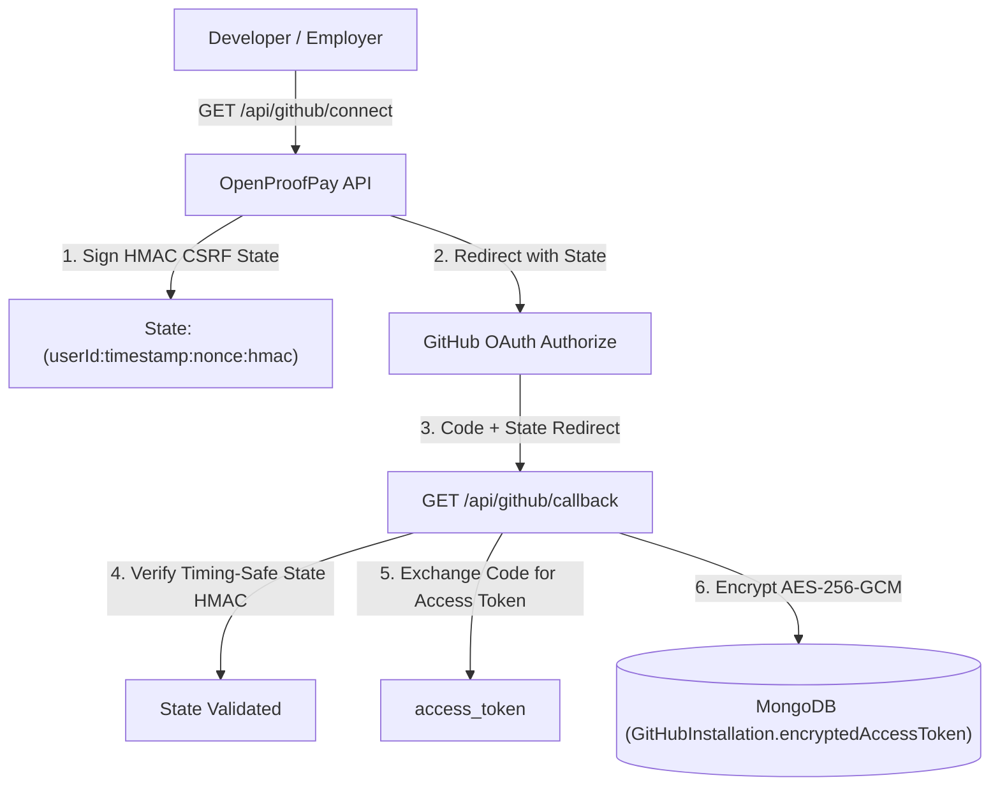

# OpenProofPay — GitHub Integration & Webhook Architecture

This guide details the GitHub App and OAuth integration architecture, token encryption, untrusted PR validation pipeline, and idempotent HMAC webhook engine for **OpenProofPay**.

---

## 1. Authentication & Token Encryption Architecture

OpenProofPay integrates with GitHub via GitHub App and OAuth Web Flow. Access tokens grant permissions to read repository branches, fetch issues, inspect pull requests, and retrieve unified file diffs.

### Zero-Secret Rule & AES-256-GCM
- **Never In Bundles (Rule 5)**: Raw GitHub access tokens are **never** returned to the Chrome Extension or Web frontend. All operations execute strictly via authenticated backend endpoints (`/api/github/*`).
- **Encrypted at Rest**: Stored tokens in `GitHubInstallation.encryptedAccessToken` are encrypted using AES-256-GCM with a 96-bit unique IV and a 128-bit authentication tag format: `ivHex:authTagHex:cipherTextHex`.

---

## 2. GitHub Service API Endpoints

| Endpoint | Method | Role | Description |
| :--- | :--- | :--- | :--- |
| `/api/github/connect` | `GET` | Authenticated | Generates signed CSRF state and returns GitHub authorization URL |
| `/api/github/callback` | `GET` | Public | Validates state signature, exchanges code, encrypts token at rest |
| `/api/github/disconnect` | `POST` | Authenticated | Revokes installation link and logs security audit event |
| `/api/github/repos` | `GET` | Authenticated | Lists accessible repositories for connected user |
| `/api/projects/:projectId/repo`| `POST` | Employer | Binds a verified `GitHubRepository` to an OpenProofPay project |
| `/api/github/repos/:owner/:repo/branches` | `GET` | Authenticated | Lists branches |
| `/api/github/repos/:owner/:repo/issues` | `GET` | Authenticated | Lists open issues (excluding PRs) |
| `/api/github/repos/:owner/:repo/issues/:issueNumber` | `GET` | Authenticated | Detailed issue spec for direct import into a Milestone Task |
| `/api/github/repos/:owner/:repo/pulls` | `GET` | Authenticated | Lists open PRs |
| `/api/github/repos/:owner/:repo/pulls/:prNumber` | `GET` | Authenticated | Detailed PR metadata with changed files and patch diffs |

---

## 3. Untrusted PR Submission Validation (Rule 14 & Section 3)

When a developer submits a PR (`POST /api/tasks/:taskId/submissions`), the backend never trusts client URLs or form inputs blindly:

1. **Developer Assignment Check**: Verifies the developer is assigned to the task (or assigns if open) and has connected their GitHub account.
2. **Repository Mismatch Guard**: Resolves the project's bound `GitHubRepository` and verifies that the PR URL originates from the exact linked repository. Attempts to submit a PR from an unrelated repository are rejected with `REPOSITORY_MISMATCH` (HTTP 400).
3. **PR Author Verification**: Fetches the PR via Octokit and verifies `pr.user.login` matches the developer's verified `githubUsername`.
4. **Immutable Commit Pinning**: Extracts the exact immutable `head.sha`, additions, deletions, and changed files.
5. **Duplicate Active Submission Guard**: Prevents redundant or duplicate jobs for the same `(taskId, headSha)`.

---

## 4. Verified & Idempotent GitHub Webhook Engine

Webhooks arrive at `POST /api/webhooks/github` and are processed through a cryptographic, idempotent pipeline:

### 4.1 Signature Verification
- Inbound requests preserve the raw body buffer in `req.rawBody`.
- Header `X-Hub-Signature-256` is verified against `GITHUB_WEBHOOK_SECRET` using `crypto.timingSafeEqual` to eliminate timing attacks.

### 4.2 Deduplication & Idempotency
- Uses the unique GitHub delivery ID (`X-GitHub-Delivery`) to reject duplicate webhook transmissions with `IGNORED_DUPLICATE` (HTTP 200).

### 4.3 Handled Events
* **`pull_request.synchronize`**:
  * Triggered when a developer pushes new commits to an open PR.
  * Marks any existing `VerificationReport` for an older commit SHA as `isOutdated: true`.
  * Updates `PullRequestSubmission.headSha` to the new commit SHA.
  * Transitions the task from `REVISION_REQUESTED` or `VERIFICATION_FAILED` back to `SUBMITTED`.
* **`issues.edited`**:
  * Syncs updated issue specifications directly into linked OpenProofPay tasks.
* **`check_run.completed`**:
  * Ingests external CI test check statuses.
