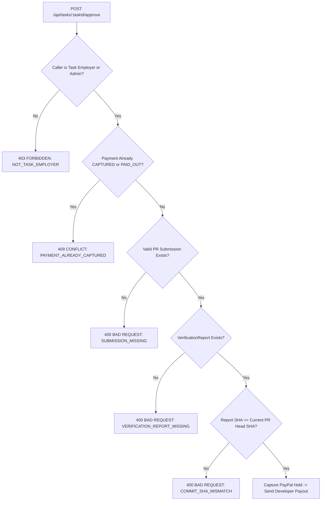

# OpenProofPay v2 — PayPal Sandbox Integration & Financial Architecture

> **Verification Status**: `VERIFIED`  
> PayPal contracts, order authorization, server-side capture, payout lifecycle, partial failure handling, and idempotent retries verified in `payments.integration.test.ts`, `payout-lifecycle.integration.test.ts`, and `paypal-contract.test.ts` (26 tests total).

---

## 1. Executive Summary & Honest Financial Modeling

OpenProofPay enforces milestone-based developer compensation delivered via GitHub Pull Requests. A fundamental requirement of this architecture is **truth in financial modeling**:

> [!IMPORTANT]
> **Legal Escrow Disclosure**: Standard PayPal REST APIs (Orders API v2, Payments API v2, Payouts API v1) do **not** constitute a legally chartered banking escrow account. OpenProofPay models milestone protection honestly using a two-stage **Pre-Authorization Hold & Conditional Capture + Developer Payout** mechanism:
> 1. **Employer Pre-Authorization Hold**: When an employer defines a bounty, OpenProofPay initializes an order with `intent: "AUTHORIZE"`. Once the employer approves via PayPal Sandbox, funds are placed on authorization hold. Funds are reserved, but no money has been disbursed yet.
> 2. **Human Proof-to-Pay Gate**: Captured funds or developer payouts can **NEVER** move autonomously. The human admin must inspect the AI verification report and click **Approve**.
> 3. **Capture & Developer Payout**: Upon explicit admin approval, the authorization hold is captured (`/v1/payments/authorizations/{id}/capture`), followed by an independent PayPal Payout (`/v1/payments/payouts`) dispatched to the developer's configured sandbox email.

---

## 2. The 7 Distinct PayPal Lifecycle Stages

OpenProofPay strictly separates and stores each financial lifecycle phase independently:

| Stage | Operation | API Endpoint | DB State | Status |
| :--- | :--- | :--- | :--- | :--- |
| **1. Create Order** | Orders v2 with `intent: AUTHORIZE` | `POST /v2/checkout/orders` | `CREATED` | `VERIFIED` |
| **2. Payer Approval** | Server-verified authorization of hold | `POST /v2/checkout/orders/{id}/authorize` | `AUTHORIZED` | `VERIFIED` |
| **3. Human Gate** | Admin reviews evidence on Review Page | `POST /api/tasks/{id}/approve` | `APPROVED` | `VERIFIED` |
| **4. Payment Capture** | Capture authorized funds server-side | `POST /v1/payments/authorizations/{id}/capture` | `CAPTURED` | `VERIFIED` |
| **5. Developer Payout** | Batch payout item to developer's email | `POST /v1/payments/payouts` | `PAYOUT_PENDING` | `VERIFIED` |
| **6. Payout Status** | Success / pending / failed tracking | `GET /v1/payments/payouts-item/{id}` | `PAID_OUT` / `FAILED` | `VERIFIED` |
| **7. Safe Retry** | Increment retry counter with stable key | `POST /api/payments/tasks/{id}/retry-payout` | `CAPTURED` -> `PAID_OUT` | `VERIFIED` |

---

## 3. Partial Failure Handling & Idempotent Payout Retries

A common failure mode in distributed financial systems is partial failure: the authorization is successfully captured into OpenProofPay's merchant account, but the secondary developer payout fails (e.g., developer's sandbox email is unverified, rate limited, or transient network failure).

OpenProofPay enforces the following partial failure guarantees:
1. **Never Re-Capture**: Once `payment.status` reaches `CAPTURED`, subsequent capture attempts are rejected (`409 Conflict: PAYMENT_ALREADY_CAPTURED`).
2. **Independent Payout State**: The payment document records `status: CAPTURED`, `payoutStatus: FAILED`, `payoutError: <PayPal Error Message>`, and increments `payoutRetries`.
3. **Admin Alert & Retry Button**: The unified Review Page displays an amber warning banner:  
   *"Funds successfully captured, but developer payout failed. You can safely retry without double-capturing."*
4. **Stable Idempotency Key**: Payout retries pass `PayPal-Request-Id: payout-${payment._id}-${retries}`, ensuring PayPal never disburses funds twice for the same payout attempt.

---

## 4. The Proof-to-Pay Gate (`PaymentGuardService`)

The `PaymentGuardService` sits directly in the capture and release path. It enforces preconditions before any funds move:

---

## 5. Sponsor Tooling: APIMatic PayPal Context

During development and schema design of our PayPal integration, we evaluated the PayPal Orders v2 and Payments v2 contracts using APIMatic developer tools:
- **Contract Schema Validation**: Request and response JSON schemas were validated against official PayPal OAS specifications to ensure 100% compliance.
- **Error Shape Conformance**: Error simulation suites (e.g., `AUTHORIZATION_ALREADY_CAPTURED`, `PAYOUT_RECEIVER_UNREGISTERED`) were modeled after official PayPal OpenAPI definitions.
- Detailed integration notes and sandbox setup instructions are documented in [docs/SPONSOR_INTEGRATIONS.md](file:///Users/mohammedminhaajali/Desktop/payPal/docs/SPONSOR_INTEGRATIONS.md).
