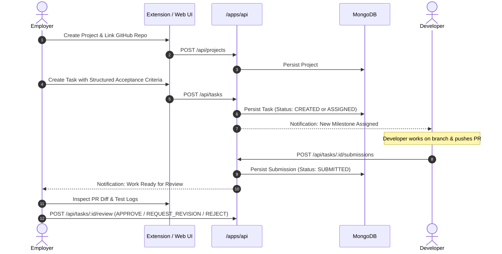

# OpenProofPay — Workflows, Review Decision Gate & Revision Loop

## 1. System Overview
Phase 5 implements the full-stack business logic and UI workflows connecting **Employers** and **Developers** across Projects, Tasks, Structured Acceptance Criteria, Pull Request Submissions, and the Human Review Decision Gate.

---

## 2. Employer Workflow Architecture



### 2.1 Project Workspace Management
- `POST /api/projects`: Employer creates a workspace with name, description, currency, and total budget.
- `GET /api/projects`: Lists active employer workspaces.
- `GET /api/projects/:id`: Returns project details with associated milestone tasks.
- `POST /api/projects/:id/repo`: Binds a GitHub repository (`GitHubRepository`) to the project.

### 2.2 Structured Acceptance Criteria Builder
Employers define explicit, testable criteria for each milestone task:
```typescript
interface IAcceptanceCriterion {
  id: string;
  title?: string;
  description: string;
  mandatory: boolean;
  category: 'FUNCTIONAL' | 'SECURITY' | 'TESTING' | 'PERFORMANCE' | 'STYLE' | 'OTHER';
}
```
- Validated via Zod `AcceptanceCriterionSchema`.
- Displayed with categorized badges in Chrome Extension Side Panel and Web Dashboard.

### 2.3 GitHub Issue Import
Employers can import milestones directly from a connected repository's GitHub Issue:
- Captures `githubIssueNumber` and `githubIssueUrl`.
- Auto-populates title and requirements.
- Active GitHub issue tab is detected in real time by `githubDetector.ts`.

---

## 3. Developer Workflow Architecture

### 3.1 Milestone Initiation (`POST /api/tasks/:id/start`)
- Transition: `ASSIGNED` $\to$ `IN_PROGRESS` (or `CREATED` $\to$ `IN_PROGRESS` upon developer claim).
- RBAC Enforcement: Only the assigned developer (or an unassigned developer claiming the task) can initiate work.
- Audit Log: `TASK_ASSIGNED` / `TASK_IN_PROGRESS` recorded with developer ID and IP address.

### 3.2 PR Submission & Revision Handling
- Endpoint: `POST /api/tasks/:id/submissions`.
- Anti-Spoofing: Verifies developer assignment, developer GitHub username matching the PR author, and linked repository match.
- State Transition: Moves task from `IN_PROGRESS` or `REVISION_REQUESTED` to `SUBMITTED`.
- Historical Integrity: Previous `VerificationReport` records are preserved and marked `isOutdated: true` upon newer commits (`synchronize` events), retaining a complete audit trail.

---

## 4. Employer Review & Decision Gate (`POST /api/tasks/:id/review`)

The review endpoint is guarded by `requireAuth`, `requireRole([EMPLOYER, ADMIN])`, and resource ownership checks.

| Action | Allowed States | Target State | Required Payload | Outcome |
| :--- | :--- | :--- | :--- | :--- |
| `APPROVE` | `AWAITING_EMPLOYER_APPROVAL`, `SUBMITTED` | `APPROVED` | `notes?: string` | Task marked `APPROVED`; latest submission linked as `acceptedSubmissionId`; unlocks PayPal payment release. |
| `REQUEST_REVISION` | `AWAITING_EMPLOYER_APPROVAL`, `SUBMITTED`, `VERIFICATION_FAILED` | `REVISION_REQUESTED` | `feedback: string` (min 5 chars), `failedCriteriaIds?: string[]` | Task marked `REVISION_REQUESTED`; developer notified; failed criteria highlighted in UI. |
| `REJECT` | `AWAITING_EMPLOYER_APPROVAL`, `SUBMITTED`, `VERIFICATION_FAILED` | `REJECTED` | `reason: string` (min 5 chars) | Task marked `REJECTED`; documented reasoning logged immutably in `latestReview` and `AuditLog`. |

### Critical Rule Enforcement: Self-Approval Prevention
Developers can never approve their own work. Even if a user has dual credentials or attempts an IDOR request, `task.assignedDeveloperId === callerId` raises `403 FORBIDDEN`.

---

## 5. Critical Rule: PR Merge != Approval

> [!IMPORTANT]
> Merging a Pull Request on GitHub NEVER triggers task approval or payment release.

In `WebhookService.handleGitHubEvent`:
```typescript
if (action === 'closed' && pull_request.merged) {
  await AuditLogModel.create({
    action: AuditAction.PR_SUBMITTED,
    resourceType: 'PullRequest',
    resourceId: submission._id.toString(),
    ipAddress,
    metadata: {
      policy: 'PR_MERGE_NEVER_TRIGGERS_APPROVAL_OR_PAYMENT',
      prNumber: pull_request.number,
      merged: true,
      taskId: submission.taskId.toString(),
      message: 'GitHub Pull Request was merged, but milestone approval and payment release require explicit human Employer review.'
    }
  });
}
```
Financial sovereignty is preserved: only the explicit employer review action `APPROVE` on `AWAITING_EMPLOYER_APPROVAL` unlocks payment capture.

---

## 6. Multi-Step State Lifecycle

```
CREATED
   │
   ▼
ASSIGNED
   │
   ▼
IN_PROGRESS ──(PR Submitted)──► SUBMITTED
                                   │
      ┌────────────────────────────┼────────────────────────────┐
      │                            │                            │
      ▼                            ▼                            ▼
REVISION_REQUESTED            VERIFYING             AWAITING_EMPLOYER_APPROVAL
      │                            │                            │
      │ (Resubmit PR)              ▼                            ▼
      └────────────────────►  VERIFICATION_PASSED         [ Employer Review Gate ]
                                                                │
                                              ┌─────────────────┼─────────────────┐
                                              ▼                 ▼                 ▼
                                           APPROVED     REVISION_REQUESTED    REJECTED
                                              │
                                              ▼
                                      PAYMENT_PROCESSING
                                              │
                                              ▼
                                      PAYMENT_COMPLETED
                                              │
                                              ▼
                                           CLOSED
```

---

## 7. Verification Gate Results
The complete test suite runs via Vitest with in-memory MongoDB:
```bash
npm --workspace=@openproofpay/api run test
```
**Results: 38/38 passing tests across 5 test suites:**
1. `src/modules/tasks/tasks.integration.test.ts` (10/10 passing)
   - Project creation via `POST /api/projects`.
   - Task creation with structured criteria and assignment.
   - Developer starting work (`ASSIGNED` $\to$ `IN_PROGRESS`).
   - Anti-IDOR task injection protection.
   - Unauthorized developer start blocking.
   - Full 8-step lifecycle loop: `CREATED` $\to$ `ASSIGNED` $\to$ `IN_PROGRESS` $\to$ `SUBMITTED` $\to$ `REVISION_REQUESTED` $\to$ `SUBMITTED` $\to$ `AWAITING_EMPLOYER_APPROVAL` $\to$ `APPROVED`.
   - Anti-self-approval gate.
   - Anti-IDOR employer review guard.
   - Rejection with mandatory documented reasoning.
   - PR Merge $\ne$ Approval autonomy barrier.
2. `src/modules/auth/rbac.integration.test.ts` (6/6 passing)
3. `src/modules/auth/auth.integration.test.ts` (9/9 passing)
4. `src/modules/github/github.integration.test.ts` (10/10 passing)
5. `src/services/TaskStateMachineService.test.ts` (3/3 passing)