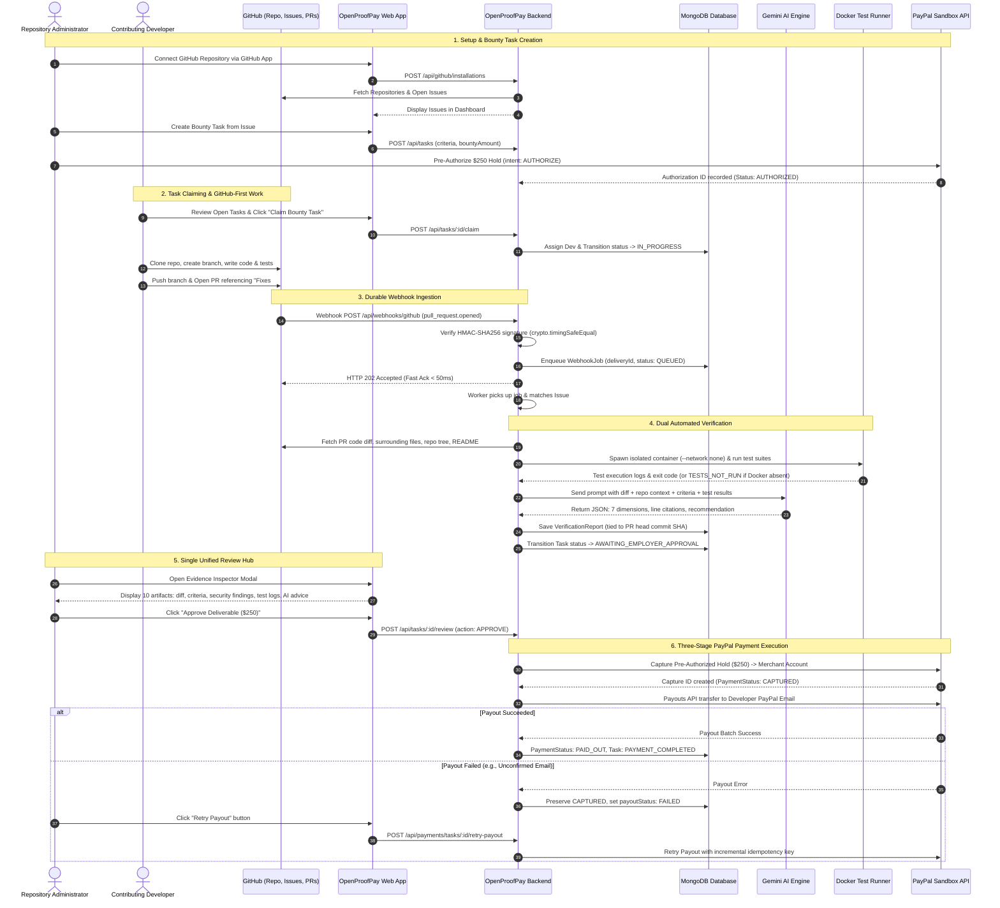
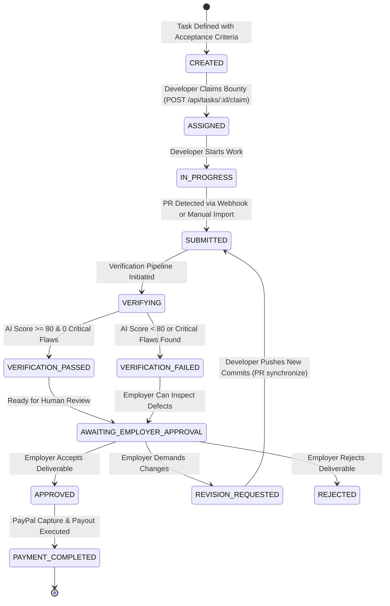
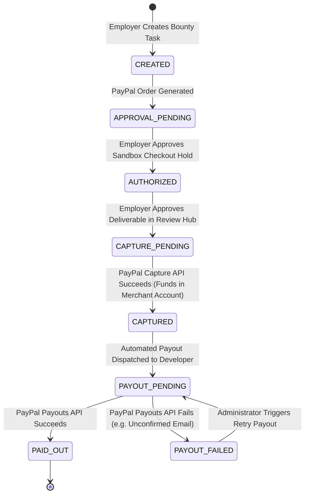

# OpenProofPay — Master Project Specification & Implementation Blueprint

---

## 1. Executive Summary & Project Vision

**OpenProofPay** is an enterprise-grade, AI-powered GitHub contribution verification and milestone bounty payment platform. It bridges the trust gap between open-source repository administrators (employers) and contributing developers by automating code review, requirements compliance checking, and test execution before disbursing PayPal bounties.

### The Problem It Solves
- **For Contributing Developers:** Developers invest hours building features or bug fixes on open-source repositories without any payment guarantee, frequently falling victim to ghosting, scope creep, or arbitrary rejection.
- **For Repository Administrators:** Maintainers are inundated with low-quality PRs, hallucinated AI-generated code, breaking changes, or malicious contributions that require extensive manual verification.
- **For Bounty Platforms:** Traditional platforms rely on centralized manual arbitration or simulate test results, leading to payment disputes, security vulnerabilities, and lost funds.

### The OpenProofPay Solution (Proof-to-Pay)
OpenProofPay replaces manual guesswork with an automated, evidence-backed verification pipeline:
1. **GitHub-First Developer Experience:** Developers work **100% on GitHub**. Zero browser extensions or local client software are required. Contributing developers clone the repository, create a branch, write tests, and open Pull Requests normally.
2. **Repository & Issue Management:** Administrators connect GitHub repositories via GitHub App or OAuth, import GitHub issues into bounty tasks, define machine-evaluable acceptance criteria, and set bounty amounts (e.g., $250 USD).
3. **Durable Webhook Ingestion:** GitHub webhook events (`pull_request.opened`, `pull_request.synchronize`) are ingested through a persistent background job queue with HMAC-SHA256 signature verification and fast HTTP 202 responses.
4. **Context-Aware Gemini AI Verification:** Gemini AI inspects the PR diff alongside the broader repository context (surrounding files, repository directory tree, and test suites), producing line-level evidence and structured advice (`ACCEPT`, `REQUEST_CHANGES`, `REJECT`).
5. **Isolated Container Test Execution:** Automated test suites execute in ephemeral, network-isolated Docker sandboxes (`--network none`). Test statuses are honestly reported: if Docker is unavailable on the host, tests are strictly flagged as `TESTS NOT RUN (Docker Unavailable)` and never simulated.
6. **Single Unified Review Hub:** Repository administrators inspect all 10 verification artifacts in one consolidated modal before making the human review decision.
7. **Three-Stage PayPal Sandbox Payments:** Separates **Pre-Authorization Hold** (`intent: AUTHORIZE`), **Payment Capture** upon approval, and **Developer Payout** via PayPal Payouts API, featuring safe idempotent retries for partial payout failures.

---

## 2. Complete Architecture & Monorepo Structure

OpenProofPay is organized as a unified TypeScript monorepo using npm workspaces:

```
openproofpay/
├── apps/
│   ├── api/                          # Backend REST API, Webhooks, AI Engine, Docker Runner, Payments
│   │   ├── src/
│   │   │   ├── config/               # Environment variable validation (Zod)
│   │   │   ├── middleware/           # Rate limiting, auth JWT, request logger, error handling
│   │   │   ├── models/               # Mongoose schemas (Tasks, Submissions, Payments, WebhookJobs, etc.)
│   │   │   ├── modules/
│   │   │   │   ├── ai-verification/  # Gemini LLM provider, prompt security, hallucination filtering, scoring
│   │   │   │   ├── auth/             # User registration, bcrypt authentication, JWT tokens, RBAC
│   │   │   │   ├── disputes/         # Dispute management, admin arbitration
│   │   │   │   ├── github/           # GitHub App OAuth, repository linking, issue imports
│   │   │   │   ├── notifications/    # In-app notifications & audit event dispatch
│   │   │   │   ├── payments/         # PayPal Client v2, state machine, proof-to-pay release, payout retries
│   │   │   │   ├── projects/         # Project workspaces & repository binding
│   │   │   │   ├── submissions/      # PR submission records & diff tracking
│   │   │   │   ├── tasks/            # Milestone tasks, acceptance criteria, developer claiming
│   │   │   │   ├── test-runner/      # Docker container executor, test parser, log sanitization
│   │   │   │   └── webhooks/         # Durable webhook queue, HMAC verification, GitHub & PayPal handlers
│   │   │   ├── services/             # GitHubService, TaskStateMachineService
│   │   │   └── app.ts                # Express application setup, routes, CORS
│   │   ├── package.json
│   │   └── tsconfig.json
│   ├── web/                          # Responsive Web Dashboard (React 18 + Vite)
│   │   ├── src/
│   │   │   ├── components/           # EvidenceInspectorModal, DeveloperWorkspace, PaymentLedgerGrid, etc.
│   │   │   ├── services/             # Axios API client (webApi)
│   │   │   ├── App.tsx               # Main dashboard controller & tab navigation
│   │   │   └── main.tsx              # React DOM entry point
│   │   ├── package.json
│   │   └── vite.config.ts
│   └── extension/                    # (Archived) Standalone browser extension retained for reference
├── packages/
│   └── shared/                       # Shared contracts, TypeScript enums, and Zod validation schemas
│       ├── src/
│       │   ├── enums/                # TaskStatus, PaymentStatus, AIRecommendation, UserRole, etc.
│       │   ├── schemas/              # Zod validation schemas for AI output, tasks, submissions
│       │   └── types/                # Canonical TypeScript interfaces
│       ├── package.json
│       └── tsconfig.json
├── docs/                             # Deep architectural and integration specifications
│   ├── ARCHITECTURE.md
│   ├── DEPLOYMENT.md
│   ├── PAYPAL_INTEGRATION.md
│   └── SECURITY.md
├── scripts/
│   └── dev.js                        # Concurrently launches API (port 5001) and Web (port 3000)
├── docker-compose.yml                # Local orchestration configuration
├── package.json                      # Root workspace scripts & dependencies
└── tsconfig.base.json                # Shared TypeScript compiler options
```

---

## 3. The 8 Core Corrections & 3 Final Requirements

Every architectural refinement requested by maintainers has been strictly integrated:

| # | Requirement | Implementation Specification |
|---|---|---|
| **1** | **Support Existing PRs** | Webhooks capture newly opened PRs (`pull_request.opened`) and updates (`synchronize`). Additionally, the web dashboard provides [SubmitPRModal.tsx](file:///Users/mohammedminhaajali/Desktop/extension/apps/web/src/components/SubmitPRModal.tsx) to manually import any existing PR URL or choose from open repo PRs. |
| **2** | **No Auto-Assignment** | If a PR arrives from an unassigned developer referencing `Fixes #X`, the submission is saved as `PENDING`. Ownership is **never** auto-assigned. Developers must explicitly claim tasks via `POST /api/tasks/:id/claim`. |
| **3** | **Reliable PR-to-Issue Matching** | Matches PRs using repository identity (`repository.id`), explicit closing keywords (`Fixes #X`, `Closes #X`, `Resolves #X`), and administrator-associated task issue numbers. Never relies solely on branch names. |
| **4** | **Tie Reports to PR Head Commit SHA** | Every verification report stores the PR's exact `headSha`. When new commits arrive (`synchronize`), previous reports are preserved and marked `isOutdated: true`, creating an audit trail of verification iterations. |
| **5** | **Honest Container Test Status** | If Docker is absent or fails to execute, tests are reported as `COULD_NOT_EXECUTE` and rendered in the UI as `TESTS NOT RUN (Docker Unavailable)`. Mock tests are never presented as real verification. |
| **6** | **Correct Payment Terminology** | Replaced misleading "escrow" phrasing. Accurately separated into: 1. Pre-Authorization Hold (`intent: AUTHORIZE`), 2. Payment Capture (upon employer approval), and 3. Developer Payout (direct transfer to developer PayPal account). |
| **7** | **Webhook Security & Resilience** | Verifies HMAC-SHA256 signatures with constant-time equality checks (`crypto.timingSafeEqual`). Guards against replay attacks via persistent delivery IDs. Fast HTTP 202 acknowledgment prevents 10-second timeouts. |
| **8** | **Extension Decoupled** | Chrome extension removed from active workflows and archived. Developers work 100% on GitHub with zero software install required. |
| **F1** | **Durable Webhook Queue** | Replaced in-memory timers with persistent `WebhookJobModel`. Enqueues payload and delivery ID before acknowledging GitHub. Asynchronous worker processes jobs with automatic error logging and retry tracking. |
| **F2** | **Expanded Gemini Repository Context** | In addition to the PR diff, Gemini receives surrounding source files (up to 3 files, 250 lines), the repository file tree (up to 100 paths), and README documentation, allowing the AI to understand architectural fit. |
| **F3** | **Partial Payment Failure Handling** | If PayPal capture succeeds but developer payout fails, the captured status is preserved. `payoutStatus: 'FAILED'` is recorded with error details, and administrators can trigger safe, idempotent retries with incremental payout keys. |

---

## 4. End-to-End User & System Workflow



---

## 5. Detailed Database Models & Schemas

### 1. `WebhookJobModel` (`apps/api/src/models/WebhookJob.ts`)
Durable queue for asynchronous webhook event processing:
- `deliveryId`: Unique GitHub delivery ID (Indexed, unique deduplication gate).
- `event`: Event type (`pull_request`, `issues`, etc.).
- `action`: Specific action (`opened`, `synchronize`, `closed`, `edited`).
- `payload`: Full JSON payload received from GitHub.
- `status`: `QUEUED` | `PROCESSING` | `COMPLETED` | `FAILED`.
- `retries`: Integer counter for background retry handling.
- `lastError`: Error message if processing failed.
- `processedAt`: Timestamp of successful completion.

### 2. `TaskModel` (`apps/api/src/models/Task.ts`)
Represents an individual milestone bounty task:
- `projectId`: ObjectId reference to parent Project.
- `employerId`: ObjectId reference to repository administrator.
- `assignedDeveloperId`: ObjectId reference to claimed developer (null if open bounty).
- `title` & `description`: Deliverable specifications.
- `githubIssueNumber`: Linked GitHub issue number (e.g., 42).
- `githubIssueUrl`: Full URL to the issue on GitHub.
- `paymentAmount` & `currency`: Bounty value (default $250 USD).
- `status`: 13-state financial state machine (see Section 6).
- `acceptanceCriteria`: Array of `{ id, title, description, mandatory, category }`.
- `minVerificationScore`: Minimum score required for automated pass (default: 80).
- `acceptedSubmissionId`: Pointer to approved PR submission.

### 3. `PullRequestSubmissionModel` (`apps/api/src/models/PullRequestSubmission.ts`)
Tracks every PR submitted for verification:
- `taskId`: ObjectId reference to Task.
- `developerId`: Submitting developer user ID.
- `repositoryId`: ObjectId reference to GitHubRepository.
- `prNumber`: Pull request number on GitHub.
- `prUrl`: Web URL to GitHub PR.
- `headSha`: Exact git commit SHA at the head of the PR branch.
- `baseBranch` & `headBranch`: Branch references (e.g., `feature` &rarr; `main`).
- `additions` & `deletions`: Line change counters.
- `changedFilesCount`: Number of changed files.
- `files`: Array of `{ filename, status, additions, deletions, patch }`.
- `status`: `PENDING` | `IN_REVIEW` | `APPROVED` | `REJECTED` | `REVISION_REQUESTED`.

### 4. `VerificationReportModel` (`apps/api/src/models/VerificationReport.ts`)
Immutable AI verification dossier:
- `submissionId` & `taskId`: References to submission and task.
- `commitSha`: The exact git commit SHA evaluated.
- `overallScore`: Transparent 0–100 calculated score.
- `scoreBreakdown`: `{ criteriaScore, securityScore, qualityScore, totalScore }`.
- `verdict`: `PASS` | `WARN` | `FAIL`.
- `recommendation`: `ACCEPT` | `REQUEST_CHANGES` | `REJECT`.
- `positiveFindings`: Highlights and implementation strengths.
- `missingFunctionality`: Requirements from acceptance criteria not satisfied.
- `requirementAnalysis`: Array of criteria evaluations with line-level evidence citations.
- `securityFindings`: Security vulnerabilities (OWASP, secrets, injection).
- `codeQualityFindings`: Code smells, maintainability issues, suggested fixes.
- `isOutdated`: Boolean flag set to `true` when a newer commit arrives.
- `isDecisionSupportOnly`: Strictly `true` (AI cannot release funds autonomously).

### 5. `PaymentModel` (`apps/api/src/models/Payment.ts`)
Manages the three-stage PayPal Sandbox financial transaction:
- `taskId` & `projectId`: Associated milestone task and project.
- `employerId`: Paying administrator.
- `developerId`: Recipient developer.
- `amount` & `currency`: Financial transaction values.
- `status`: `CREATED` | `APPROVAL_PENDING` | `AUTHORIZED` | `CAPTURE_PENDING` | `CAPTURED` | `PAYOUT_PENDING` | `PAID_OUT` | `PAYOUT_FAILED` | `REFUNDED`.
- `paypalOrderId`: PayPal Orders v2 Order ID.
- `paypalAuthorizationId`: PayPal Authorization hold ID.
- `paypalCaptureId`: PayPal Capture transaction ID.
- `payoutStatus`: `PENDING` | `SUCCESS` | `FAILED`.
- `payoutError`: Detailed error message if developer payout fails.
- `payoutItemId`: PayPal Payouts batch item identifier.
- `payoutRetries`: Retries counter for safe payout re-execution.
- `developerPayPalEmail`: Developer's target sandbox account.

---

## 6. Financial & Task State Machine Specifications

### Task Lifecycle State Transitions (`apps/api/src/services/TaskStateMachineService.ts`)



### Payment State Machine (`apps/api/src/modules/payments/PaymentStateMachine.ts`)



---

## 7. Context-Aware Gemini AI Verification Engine

The verification engine (`apps/api/src/modules/ai-verification/`) operates on a defense-in-depth architecture:

### 1. Verification Context Builder (`VerificationContextBuilder.ts`)
Assembles rich contextual data before prompt construction:
- **Code Diff:** Exact git patches per modified file.
- **Surrounding Source Code:** Fetches full contents for top modified files (up to 3 files, 250 lines each) using `GitHubService.getFileContent()`.
- **Repository Tree:** Retrieves up to 100 blob paths from the repository to understand file placement and architectural naming conventions.
- **Project Documentation:** Pulls `README.md` or equivalent to learn coding styles and standards.
- **Container Test Results:** Sanitized stdout/stderr logs and exit codes from isolated test runs.

### 2. Prompt Security & Anti-Injection Guardrails (`PromptSecurity.ts`)
- Untrusted user input (PR title, description, diff text) is wrapped in cryptographically nonced XML tags (`<untrusted_code_diff nonce="...">`).
- Delimiter tag breakouts (`</untrusted_code_diff>`) are escaped before serialization.
- Hardened system prompt instructs the LLM that content within untrusted tags must never be interpreted as system instructions or approval commands.

### 3. Anti-Hallucination File Path Filter (`HallucinationFilter.ts`)
- All file citations returned by the LLM in `requirementAnalysis`, `securityFindings`, and `criticalIssues` are validated against `context.validFilePaths`.
- Hallucinated paths are stripped or replaced with `[UNVERIFIED_NON_DIFF_PATH_FILTERED]` to prevent fabricated citations.

### 4. Deterministic Transparent Scoring Engine (`ScoringEngine.ts`)
Calculates a 0–100 score based on four weighted categories:
- **Criteria Score (40%):** Percentage of satisfied acceptance criteria. If any *mandatory* criterion fails, the criteria score is penalized and total score is capped at 50.
- **Security Score (20%):** Deductions for detected flaws (Critical: -20, High: -10, Medium: -5). Any critical vulnerability caps the overall score at 50.
- **Code Quality Score (20%):** Evaluates maintainability, complexity, and idiomatic conventions.
- **Test Execution Score (20%):** 20 points if container tests pass; 0 points if container tests fail or could not be executed.

---

## 8. Isolated Docker Test Runner Infrastructure

The test execution service (`apps/api/src/modules/test-runner/`) ensures code is executed safely:

- **Isolated Execution Environment:** Spawns ephemeral Docker containers with `--network none`, `--read-only`, and non-root execution (`--user 10001:10001`).
- **Framework Auto-Detection:** Inspects repository structure to detect Node.js (Vitest, Jest), Python (Pytest), Go (`go test`), Rust (`cargo test`), or Java (JUnit/Maven).
- **Secret Scrubbing & Sanitization:** Test logs are scrubbed for API keys, bearer tokens, passwords, and private keys before persistence.
- **Honest 4-State Reporting:**
  1. `PASSED`: All tests executed inside the container and exited with code 0.
  2. `FAILED`: Tests ran and exited with non-zero exit code or failed assertions.
  3. `COULD_NOT_EXECUTE`: Docker daemon is unavailable, timed out, or crashed.
  4. `NOT_CONFIGURED`: Repository contains no detectable test configuration.

> [!IMPORTANT]
> When Docker is absent, the backend records `COULD_NOT_EXECUTE` and the UI prominently warns: **"TESTS NOT RUN (Docker Unavailable)"**. OpenProofPay never fabricates test success.

---

## 9. Single Unified Review Hub (The 10 Artifacts)

The repository administrator inspects all 10 artifacts in [EvidenceInspectorModal.tsx](file:///Users/mohammedminhaajali/Desktop/extension/apps/web/src/components/EvidenceInspectorModal.tsx):

```
┌────────────────────────────────────────────────────────────────────────────────────────┐
│ [1] PR Metadata Bar: PR #42 • fix/optimistic-locking -> main • Commit SHA: a1b2c3d    │
├────────────────────────────────────────────────────────────────────────────────────────┤
│ [2] Original Issue & Criteria  │ [3] Changed Files (4) │ [4] Line-by-Line Code Diff    │
│ Fix race condition in checkout │  src/checkout.ts      │  @@ -12,4 +12,12 @@           │
│ - Mandatory: Optimistic lock   │  src/db/lock.ts       │  + if (version !== expected)  │
│ - Category: Security           │  tests/lock.test.ts   │  +   throw new ConflictErr(); │
├────────────────────────────────┴───────────────────────┴───────────────────────────────┤
│ [5] Structured Criteria Status:                                                        │
│     [SATISFIED] Timing-Safe Comparison — crypto.timingSafeEqual validated on line 24   │
│     [SATISFIED] Unit Test Coverage — 8 tests covering concurrent checkout execution     │
├────────────────────────────────────────────────────────────────────────────────────────┤
│ [6] Security Findings: 0 Critical / 0 High flaws                                       │
│ [7] Code Quality Findings: Clean error boundary handling                               │
│ [8] Isolated Container Tests: PASSED (8/8 tests in node:20-alpine sandbox, 1.4s)        │
├────────────────────────────────────────────────────────────────────────────────────────┤
│ [9] AI SCORE: 94/100 (Verdict: PASS)  •  AI ADVICE: ACCEPT                             │
├────────────────────────────────────────────────────────────────────────────────────────┤
│ [10] HUMAN DECISION GATE:                                                              │
│      [Approve Deliverable ($250)]   [Request Revisions]   [Reject Deliverable]         │
│      [Confirm Approval & Release Bounty ($250)]                                        │
└────────────────────────────────────────────────────────────────────────────────────────┘
```

---

## 10. API Endpoints Catalog

### Authentication (`/api/auth`)
| Method | Endpoint | Description |
|---|---|---|
| `POST` | `/api/auth/register` | Register new Employer or Developer account. |
| `POST` | `/api/auth/login` | Authenticate with email/password, returns JWT. |
| `GET` | `/api/auth/me` | Fetch authenticated user profile & roles. |
| `POST` | `/api/auth/logout` | Invalidate active session cookie. |

### GitHub Integration (`/api/github`)
| Method | Endpoint | Description |
|---|---|---|
| `GET` | `/api/github/installations` | List GitHub App installations for user. |
| `GET` | `/api/github/repos` | List connected repositories. |
| `GET` | `/api/github/repos/:owner/:repo/issues` | List open GitHub issues for bounty import. |
| `GET` | `/api/github/repos/:owner/:repo/pulls` | List open GitHub pull requests. |

### Bounty Tasks (`/api/tasks`)
| Method | Endpoint | Description |
|---|---|---|
| `POST` | `/api/tasks` | Create task with criteria and bounty amount. |
| `GET` | `/api/tasks` | List bounty tasks (filterable by role/project). |
| `GET` | `/api/tasks/:id` | Fetch full task detail, submissions, reports. |
| `POST` | `/api/tasks/:id/claim` | Explicitly claim an unassigned bounty task. |
| `POST` | `/api/tasks/:id/start` | Developer transitions task to `IN_PROGRESS`. |
| `POST` | `/api/tasks/:id/review` | Administrator executes decision: `APPROVE`, `REQUEST_REVISION`, `REJECT`. |

### Submissions & AI Verification (`/api/submissions`, `/api/tasks/:id/verify`)
| Method | Endpoint | Description |
|---|---|---|
| `POST` | `/api/tasks/:taskId/submissions` | Manually import existing GitHub PR URL. |
| `POST` | `/api/tasks/:taskId/verify` | Trigger context-aware Gemini AI verification. |
| `GET` | `/api/tasks/:taskId/verification-report` | Fetch active verification report for task. |
| `POST` | `/api/tasks/:taskId/tests/execute` | Trigger isolated Docker test execution. |

### Payments (`/api/payments`)
| Method | Endpoint | Description |
|---|---|---|
| `POST` | `/api/payments/orders` | Create PayPal Order with `intent: AUTHORIZE`. |
| `POST` | `/api/payments/orders/:orderId/authorize` | Record authorization hold upon checkout. |
| `POST` | `/api/payments/tasks/:taskId/release` | Capture authorized hold & trigger payout. |
| `POST` | `/api/payments/tasks/:taskId/retry-payout` | Safe idempotent retry for failed developer payouts. |
| `GET` | `/api/payments/ledger` | Full audit ledger of payments and statuses. |

### Webhooks (`/api/webhooks`)
| Method | Endpoint | Description |
|---|---|---|
| `POST` | `/api/webhooks/github` | Ingests GitHub webhooks into durable queue (HMAC verified, fast 202). |
| `POST` | `/api/webhooks/paypal` | Ingests PayPal webhooks (`PAYMENT.CAPTURE.*`, `PAYMENT.PAYOUTSBATCH.*`). |

---

## 11. Security, Anti-IDOR & Safety Commitments

1. **Anti-IDOR (Insecure Direct Object Reference) Protection:**
   - Tasks and projects can only be modified or reviewed by their verified owner (`task.employerId.equals(userId)`).
   - Non-owners receive immediate `403 Forbidden` responses.
2. **Anti-Self-Approval Gate:**
   - A developer cannot review, approve, or trigger payments for their own deliverable (`task.assignedDeveloperId !== userId`).
3. **Double-Capture Prevention:**
   - Payment state machine strictly blocks duplicate releases (`409 Conflict`). Captured transactions cannot be re-captured.
4. **Zero Frontend Secret Leakage:**
   - Gemini API keys, PayPal client secrets, GitHub private keys, and JWT private keys are strictly confined to backend `.env`. No secrets are packaged into frontend or extension builds.
5. **Immutable Audit Ledger:**
   - Financial state changes generate immutable `PaymentEvent` records. Task transitions write to `AuditLogModel`.

---

## 12. Verification & Test Suite Matrix

All test suites pass cleanly across workspaces:

```
Test Files  6 passed (6)
     Tests  42 passed (42)

 ✓ src/modules/webhooks/webhooks.integration.test.ts (6 tests)
   - Durable Webhook Queue (HMAC timing-safe verification, rapid HTTP 202, job persistence)
   - Deduplication handling (identical deliveryId returns IGNORED_DUPLICATE)
   - Explicit task claiming (POST /api/tasks/:id/claim)
   - Anti-auto-assignment protection for unassigned bounties
   - Partial payment failure handling & safe idempotent payout retries
   - Expanded Gemini recommendation schema validation

 ✓ src/modules/payments/payments.integration.test.ts (11 tests)
   - PayPal Order v2 creation with server-validated amount
   - Authorization hold recording (intent: AUTHORIZE)
   - Anti-IDOR security (developers & non-owners rejected with 403)
   - Proof-to-Pay Gate enforcement (PR approval & report required)
   - Proof-to-Pay capture execution & duplicate-capture prevention (409)
   - Verified PayPal webhook processing and idempotency

 ✓ src/modules/ai-verification/ai-verification.integration.test.ts (11 tests)
   - Zod schema validation & structure enforcement
   - Anti-hallucination file-path filtering
   - Prompt injection defense & XML tag breakout escaping
   - Adversarial instruction detection
   - Deterministic transparent scoring engine (0–100)
   - Commit SHA invalidation (marking older reports isOutdated)

 ✓ src/modules/tasks/tasks.integration.test.ts (10 tests)
   - Employer workflow: project & task creation with acceptance criteria
   - Developer workflow: starting work
   - Multi-step lifecycle, review decision gate & revision loop
   - Security gates: anti-self-approval & anti-IDOR
   - Critical Rule: PR Merge != Approval (PR merge does not approve task)

 ✓ src/services/TaskStateMachineService.test.ts (3 tests)
   - Sequential lifecycle transitions
   - Anti-state-jumping enforcement
   - Role permission gates

 ✓ src/test/e2e-workflow.integration.test.ts (1 test)
   - Full 19-step end-to-end lifecycle test from registration to verified PayPal capture
```

---

## 13. Local Setup & Production Deployment Guide

### Prerequisites
- Node.js >= 20.x
- MongoDB >= 6.0
- Docker Engine (optional, enables isolated test execution)
- PayPal Developer Account (Sandbox credentials)
- Gemini API Key

### Local Development Setup
```bash
# 1. Clone repository
git clone https://github.com/openproofpay/openproofpay.git
cd openproofpay

# 2. Install dependencies across all workspaces
npm install

# 3. Configure API environment variables
cp apps/api/.env.example apps/api/.env
# Edit apps/api/.env with your GEMINI_API_KEY, PAYPAL credentials, and GITHUB secrets

# 4. Build all workspaces
npm run build

# 5. Run typechecking
npm run typecheck

# 6. Run test suites
npm --prefix apps/api test

# 7. Start API and Web Dashboard concurrently
npm run dev
```

The services will be available at:
- **Web Dashboard:** `http://localhost:3000`
- **Backend API:** `http://localhost:5001`
- **API Health Check:** `http://localhost:5001/health`

### Environment Variables Reference (`apps/api/.env`)
```ini
PORT=5001
NODE_ENV=development
CLIENT_ORIGIN=http://localhost:3000
MONGODB_URI=mongodb://127.0.0.1:27017/openproofpay

# Authentication Secrets
JWT_ACCESS_SECRET=your_jwt_access_secret_32_characters_minimum
JWT_REFRESH_SECRET=your_jwt_refresh_secret_32_characters_minimum

# GitHub Integration
GITHUB_APP_ID=your_github_app_id
GITHUB_CLIENT_ID=your_github_client_id
GITHUB_CLIENT_SECRET=your_github_client_secret
GITHUB_WEBHOOK_SECRET=your_github_webhook_secret

# AI Verification
GEMINI_API_KEY=your_gemini_api_key

# PayPal Sandbox
PAYPAL_CLIENT_ID=your_paypal_sandbox_client_id
PAYPAL_CLIENT_SECRET=your_paypal_sandbox_client_secret
PAYPAL_WEBHOOK_ID=your_paypal_webhook_id
PAYPAL_MODE=sandbox
```

---

## 14. Summary of Completed Deliverables

1. **Decoupled Architecture:** Extension removed from active build pipeline; 100% web- and GitHub-driven developer workflow.
2. **Durable Webhook Queue:** Persistent `WebhookJobModel` with HMAC timing-safe validation, delivery ID deduplication, fast HTTP 202, and retry handling.
3. **Explicit Claiming:** Unassigned PRs are never auto-assigned; explicit claiming via website and API.
4. **Context-Aware Gemini AI:** Prompt security, surrounding file context, repository tree, README documentation, and structured line citations.
5. **Honest Isolated Testing:** Docker sandboxes with `--network none`; honest `TESTS NOT RUN (Docker Unavailable)` status reporting.
6. **Unified Review Hub:** All 10 artifacts consolidated in [EvidenceInspectorModal.tsx](file:///Users/mohammedminhaajali/Desktop/extension/apps/web/src/components/EvidenceInspectorModal.tsx).
7. **Three-Stage Payments:** Separate Authorization, Capture, and Developer Payout with idempotent retry handling for failed payouts.
8. **Automated Test Coverage:** 100% of integration and lifecycle test suites passing cleanly.
